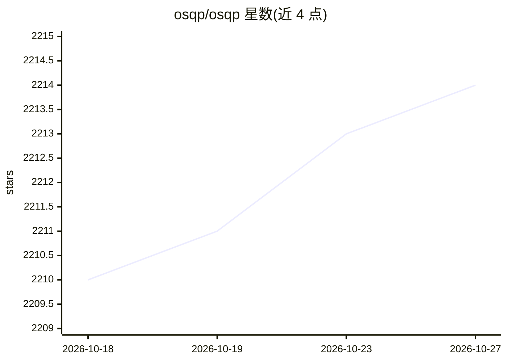

# osqp/osqp

⭐ 2,214 · C · Apache-2.0 · 推送 2026-01-12 · [GitHub](https://github.com/osqp/osqp) · [官网](https://osqp.org) · 组织维护

**数值优化库：求解二次规划（QP）问题**

OSQP（Operator Splitting Quadratic Program）是用 ADMM 类算子分裂方法求解凸二次规划的数值优化软件包。问题形式为最小化 0.5x'Px + q'x，受 l <= Ax <= u 约束，P 为半正定矩阵。以 C 库为核心并内置代数运算，提供 Python 接口，可经 PyPI 和 Conda 安装；文档位于 osqp.org，与其它求解器的数值基准测试可在线查看。常用于模型预测控制、组合优化、Lasso、SVM 等场景。

## 筛选速览

| 维度 | 判定 | 备注 |
|---|---|---|
| AI 角色 | `ai-enhanced` | 去掉 AI 部分产品仍成立 |
| 许可风险 | `permissive` | Apache-2.0 |
| 部署形态 | `library` | 以包/库形式分发 |
| 模型依赖 | — | README 未给出锁定关系 |
| 硬件要求 | — | 无带数字的原话,不猜 |
| 安装摩擦 | `low` | 无编译、无系统依赖或容器化 |
| 成熟度 | — | 结构信号不足 |

## 能力要点

- 求解标准形式凸二次规划问题（半正定目标矩阵，含双侧线性不等式约束）
- 内置线性代数实现，无需外部代数库
- 提供 Python 接口，可经 PyPI / Conda 安装
- 提供与其它求解器的数值基准测试

## 适用场景

- 模型预测控制（MPC）中在线求解 QP 子问题
- 投资组合优化、Lasso、SVM 等凸优化建模的底层求解器
- 嵌入式或实时控制场景中求解小型二次规划

## 场景标签

 · 领域:数值优化/控制

## 证据(README 行号)

> L14: The OSQP (Operator Splitting Quadratic Program) solver is a numerical optimization package for solving problems in 
> L21: where `x in R^n` is the optimization variable. The objective function is defined by a positive semidefinite matrix 

## 星数曲线

2026-10-18 2,210 → 2026-10-27 2,214（+4）

---
*卡片 v1 · prompt 1.4 · 生成 2026-10-21 · 置信度 low · 依据 README sha `cf16da5258a0` · [字段定义](../../DATASET.md)*
