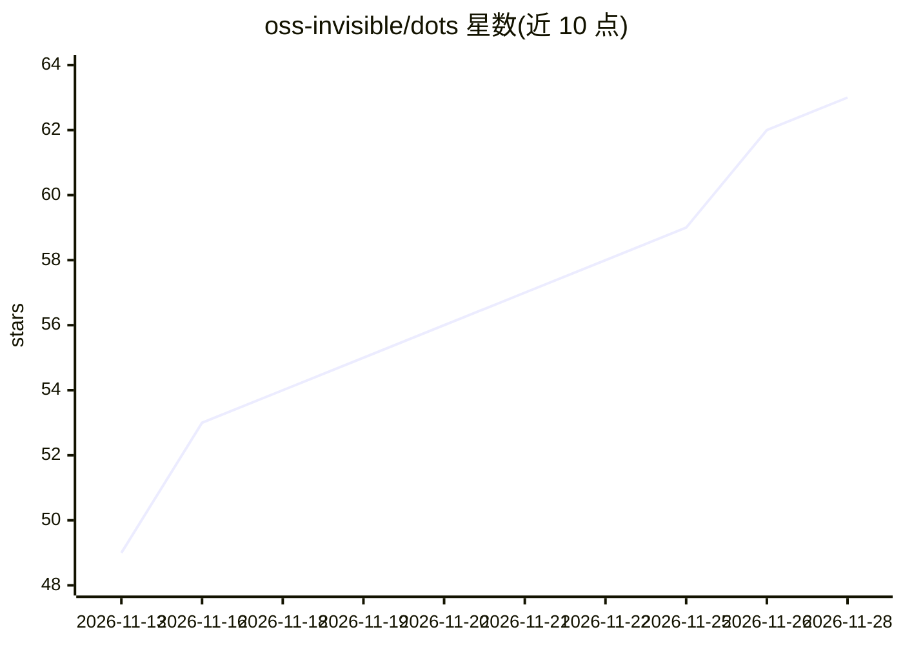

# oss-invisible/dots

⭐ 63 · TypeScript · MIT · 推送 2026-11-27 · [GitHub](https://github.com/oss-invisible/dots) · [官网](https://github.com/feder-cr/invisible_dots/blob/main/docs/guide.md) · 个人维护

**自托管反检测 AI 浏览器代理，替用户长期操作电脑任务**

开源、自托管的自主 agent 产品，定位为 OpenAI Dots、Grok Bot、Claude Cowork 等的自托管替代。每个 Dot 运行在硬件加速的 Linux 桌面虚拟机中，使用 C++ 补丁过的 Firefox（invisible_playwright_mcp）规避反 bot 检测，支持持久记忆、MCP 服务器接入、权限管控（allow/ask/deny）、任务队列与定时自动化，可通过 Web UI、CLI、HTTP API、Telegram、WhatsApp 访问。模型接入需自备 OpenRouter key。安装需 Node 24+、Go 1.25+、Git 与 x86-64 硬件虚拟化，setup 过程安装 QEMU 并启用 KVM/WHVP。项目自标状态为 alpha。

## 筛选速览

| 维度 | 判定 | 备注 |
|---|---|---|
| AI 角色 | `ai-native` | 本体是模型或模型工具 |
| 许可风险 | `permissive` | MIT |
| 部署形态 | `None` |  |
| 模型依赖 | locked-api |  |
| 硬件要求 | — | 无带数字的原话,不猜 |
| 安装摩擦 | `low` | 无编译、无系统依赖或容器化 |
| 成熟度 | `idea` | |

## 能力要点

- 每个 Dot 拥有独立硬件加速 VM、Linux 桌面与持久磁盘
- C++ 引擎内改指纹的 Firefox 浏览器，按身份隔离 cookies 与登录
- 任务队列、定时自动化与崩溃后不重复执行的工具调用语义
- 权限系统 allow/ask/deny，ask 请求进入 Inbox 并跨重启保留

## 适用场景

- 让 agent 用独立浏览器身份长期监控网页信息并写入文件
- 定时自动登录网站下载发票等重复性操作
- 通过 Telegram/WhatsApp 与自托管 agent 对话交互

## 场景标签

`浏览器自动化` `AI 助手` · 领域:效率与自动化

## 证据(README 行号)

> L1: invisible_dots, an open-source, self-hosted alternative to OpenAI Dots, Meta Muse, Grok Bot, Manus Cue and Claude Co
> L54: |**A computer of its own**|A hardware-accelerated VM with a Linux desktop and a persistent disk. It sleeps when idl
> L10: You need Node 24+, Go 1.25+, Git and hardware virtualization (x86-64), plus an OpenRouter key.

## 星数曲线

2026-11-13 49 → 2026-11-28 63（+14）

---
*卡片 v1 · prompt 1.4 · 生成 2026-11-18 · 置信度 high · 依据 README sha `4f46c0df2612` · [字段定义](../../DATASET.md)*
