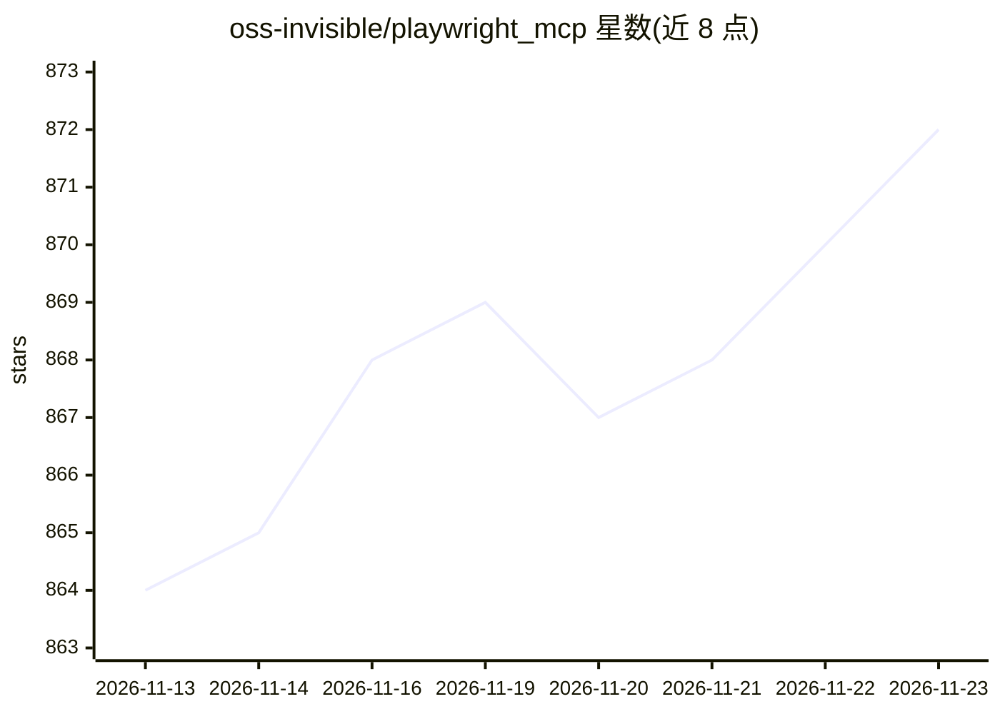

# oss-invisible/playwright_mcp

⭐ 872 · Python · MIT · 推送 2026-11-20 · [GitHub](https://github.com/oss-invisible/playwright_mcp) · [官网](https://github.com/feder-cr/invisible_playwright_mcp/wiki) · 个人维护

**反检测隐身浏览器 MCP 服务器：让 AI 代理绕过反爬浏览网页**

以 MCP 服务器形式提供的隐身浏览器自动化工具，基于反检测 Firefox 引擎，供 Claude Code、Codex、Gemini CLI 等 AI 助手驱动真实浏览器完成点击、表单与数据读取；也可通过 uvx 启动独立 Web UI（聊天+实时浏览器），使用用户自备的 OpenRouter key（默认模型 z-ai/glm-5.3-flash）。支持代理、固定 seed 身份、配置文件持久化等选项；数据本地存储，无自有服务器。配套 wiki 收录浏览器代理对比与示例。

## 筛选速览

| 维度 | 判定 | 备注 |
|---|---|---|
| AI 角色 | `ai-ecosystem` | LLM/agent 周边工具 |
| 许可风险 | `permissive` | MIT |
| 部署形态 | `None` |  |
| 模型依赖 | locked-api |  |
| 硬件要求 | — | 无带数字的原话,不猜 |
| 安装摩擦 | `low` | 无编译、无系统依赖或容器化 |
| 成熟度 | — | 结构信号不足 |

## 能力要点

- MCP 服务器可接入 Claude Code / Codex / Gemini CLI 等助手
- 基于反检测 Firefox 引擎，替代常规 Playwright 浏览器
- 独立 Web UI 模式：左侧对话、右侧实时浏览器，经 OpenRouter 调用模型
- 支持代理、seed 固定身份、profile 目录保持登录状态

## 适用场景

- 让编程助手或 CLI agent 自动操作需要真实浏览器的网站
- 在独立 Web UI 中用自然语言指挥浏览器完成查询与抓取
- 需要保持登录态与固定浏览器身份的自动化任务

## 场景标签

`浏览器自动化` `网页抓取` · 领域:效率与自动化

## 证据(README 行号)

> L1: invisible_playwright_mcp, a browser agent anti-bots cannot see. An animation: asked in Claude Code for the cheapest 
> L29: claude plugin marketplace add oss-invisible/playwright_mcp
> L56: uvx invisible-playwright-mcp ui --openrouter-key sk-or-...

## 星数曲线

2026-11-13 864 → 2026-11-23 872（+8）

---
*卡片 v1 · prompt 1.4 · 生成 2026-11-17 · 置信度 high · 依据 README sha `ed16d6cb3029` · [字段定义](../../DATASET.md)*
