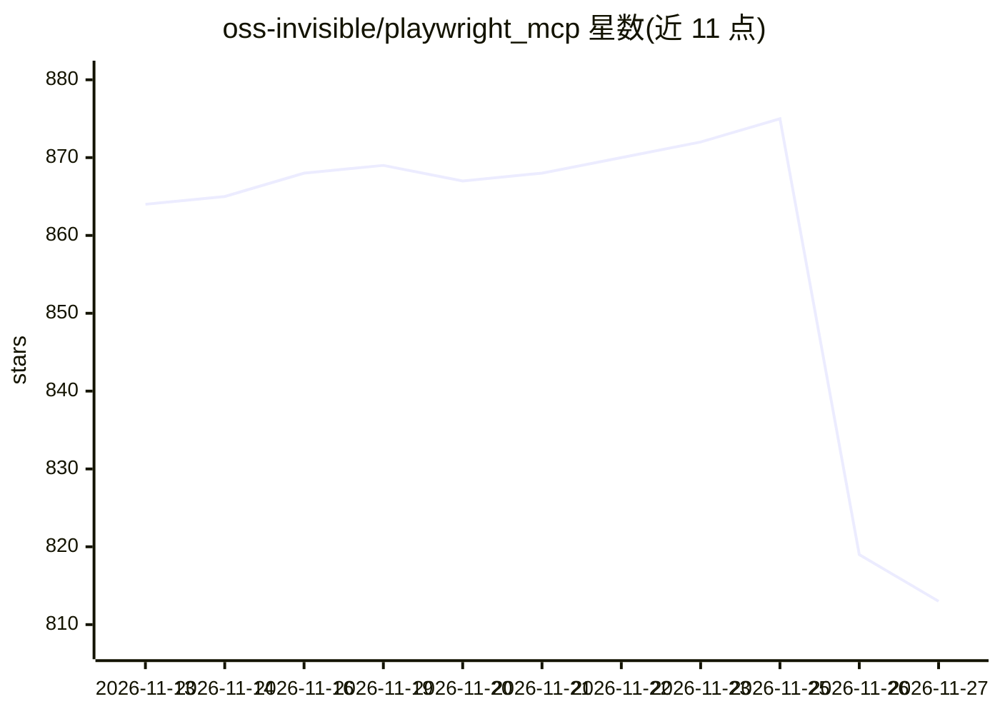

# oss-invisible/playwright_mcp

⭐ 813 · Python · MIT · 推送 2026-11-24 · [GitHub](https://github.com/oss-invisible/playwright_mcp) · [官网](https://github.com/feder-cr/invisible_playwright_mcp/wiki) · 个人维护

**给 AI 助手接入反检测隐身 Firefox 的浏览器自动化 MCP 服务器**

以 MCP 服务器形式接入 Claude Code/Codex/Gemini CLI 等客户端，让 AI agent 在隐身 Firefox 中驱动网页；也可独立运行自带 Web UI（左侧对话、右侧实时浏览器），需自备 OpenRouter key。通过 uvx 运行，支持代理、seed 固定浏览器指纹、profile 目录保留登录态、浏览器网络流量被动记录与过滤。引擎首次启动时从 GitHub release 下载，本地运行，无自有服务器。

## 筛选速览

| 维度 | 判定 | 备注 |
|---|---|---|
| AI 角色 | `ai-ecosystem` | LLM/agent 周边工具 |
| 许可风险 | `permissive` | MIT |
| 部署形态 | `None` |  |
| 模型依赖 | locked-api |  |
| 硬件要求 | — | 无带数字的原话,不猜 |
| 安装摩擦 | `low` | 无编译、无系统依赖或容器化 |
| 成熟度 | — | 结构信号不足 |

## 能力要点

- 作为 MCP 服务器接入 Claude Code/Codex/Gemini CLI
- 独立 Web UI 模式，浏览器窗口实时可见
- seed 固定浏览器指纹，--proxy 使时区/地区随代理出口
- browser_network 被动记录流量，cookie/授权头在捕获时脱敏

## 适用场景

- 让 Claude Code 里的 agent 逐日点击日历查询票价等需真实浏览器操作的任务
- 用自带 Web UI 直接对话让 agent 浏览网页
- 为自动化配置代理与固定指纹以保持会话一致

## 场景标签

`浏览器自动化` · 领域:效率与自动化

## 证据(README 行号)

> L11: ### 1. From your assistant, over MCP
> L145: The MCP server from option 1 ships inside this package: `invisible_playwright_mcp` with no

## 星数曲线

2026-11-13 864 → 2026-11-27 813（-51）

---
*卡片 v1 · prompt 1.4 · 生成 2026-11-24 · 置信度 high · 依据 README sha `d765d6fc68a7` · [字段定义](../../DATASET.md)*
