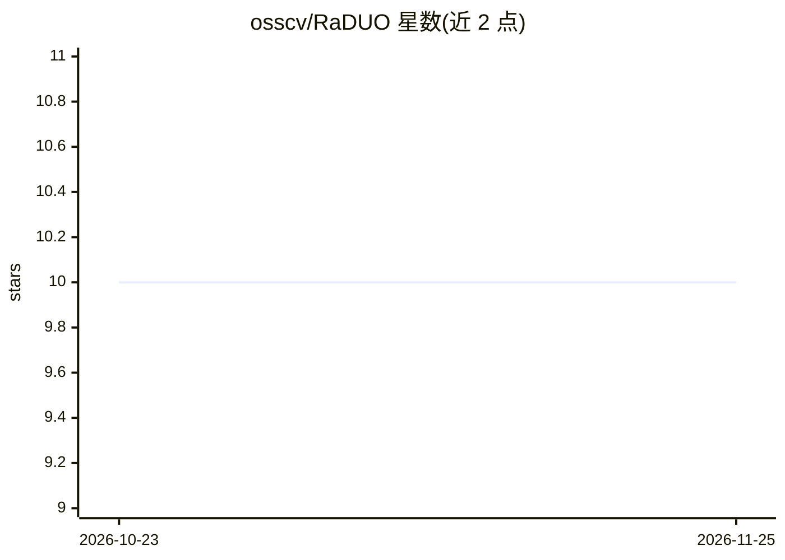

# osscv/RaDUO

⭐ 10 · Python · 推送 2026-09-12 · [GitHub](https://github.com/osscv/RaDUO) · [官网](https://www.dkly.net/projects/9) · 个人维护

**把电台直播转成多语言 STT 数据集的工具，供 ASR 研究用**

RaDUO（Radio Dataset Utility and Organizer）并行录制多个广播电台，将流切成约 20-30 秒音频片段，调用可配置的 STT 端点转写，计算基础音频质量特征，并写入可检索元数据。产出 16 kHz 单声道 WAV、转写文本、电台/语言标签及可选词级时间戳，支持导出 CSV、JSONL、Excel 与 Hugging Face audiofolder 格式元数据。带桌面 GUI 管理电台源、ASR 模型与回退链、API key 与用量限额。工具定位为数据集准备工具，声明不保障转写准确性。

## 筛选速览

| 维度 | 判定 | 备注 |
|---|---|---|
| AI 角色 | `ai-ecosystem` | LLM/agent 周边工具 |
| 许可风险 | `none` | — |
| 部署形态 | `library` | 以包/库形式分发 |
| 模型依赖 | — | README 未给出锁定关系 |
| 硬件要求 | — | 无带数字的原话,不猜 |
| 安装摩擦 | `medium` | 含编译或系统依赖之一 |
| 成熟度 | — | 结构信号不足 |

## 能力要点

- 并行录制多电台并切分为约 20-30 秒片段后送 STT 转写
- 支持配置多 ASR 提供方、语言路由与有序回退链
- 导出 CSV/JSONL/Excel 与 Hugging Face audiofolder 元数据
- 桌面 GUI 覆盖电台发现、转写编辑、数据集统计与重试

## 适用场景

- 为 ASR 模型训练收集多语言语音转写数据
- 构建带电台与语言标签的可检索语音数据集
- 按语言或地区筛选采集粤语、马来语等目标语料

## 场景标签

 · 领域:语音/数据集构建

## 证据(README 行号)

> L6: **RaDUO** (Radio Dataset Utility and Organizer) turns live radio broadcasts into a multilingual speech-to-text (STT)
> L54: - Sends clips to configurable STT providers, including OpenAI-compatible gateways, Qwen, ElevenLabs, RevoLab, Deepg
> L61: RaDUO also includes a desktop GUI for managing the complete dataset workflow.

## 星数曲线

2026-10-23 10 → 2026-11-25 10（+0）

---
*卡片 v1 · prompt 1.4 · 生成 2026-11-19 · 置信度 high · 依据 README sha `2fc736cac43d` · [字段定义](../../DATASET.md)*
