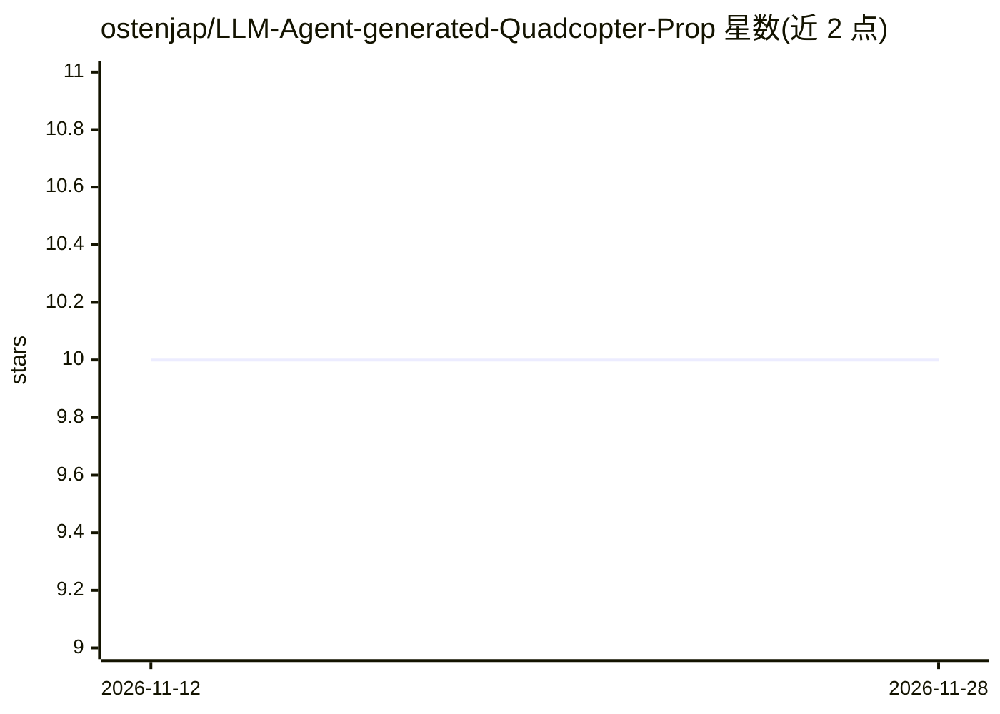

# ostenjap/LLM-Agent-generated-Quadcopter-Prop

⭐ 10 · Python · MIT · 推送 2026-06-26 · [GitHub](https://github.com/ostenjap/LLM-Agent-generated-Quadcopter-Prop) · 个人维护

**用本地 LLM 多智能体自动设计并优化四轴无人机螺旋桨**

自主多智能体系统：本地 LLM（经 Ollama 运行 qwen2.5-coder:7b、phi4-mini）负责提出与变异螺旋桨设计方案，CadQuery 脚本将 7 参数设计转为 STEP/STL 几何，手写物理代码（BEMT、噪声模型、结构校验）评分并维护三目标 Pareto 前沿，Antigravity 作为主控 agent 反思并推进循环；可选 OpenFOAM CFD 验证，Gaussian Process 代理模型减少仿真次数。结果持久化于 SQLite，支持中断续跑与隔夜运行。API 成本为零，需 Python 3.10+。

## 筛选速览

| 维度 | 判定 | 备注 |
|---|---|---|
| AI 角色 | `ai-native` | 本体是模型或模型工具 |
| 许可风险 | `permissive` | MIT |
| 部署形态 | `library` | 以包/库形式分发 |
| 模型依赖 | local-ok | 支持本地模型 |
| 硬件要求 | — | 无带数字的原话,不猜 |
| 安装摩擦 | `low` | 无编译、无系统依赖或容器化 |
| 成熟度 | — | 结构信号不足 |

## 能力要点

- LLM 仅提出设计、由物理代码评分的职责分离机制
- CadQuery 参数化生成 watertight STEP/STL（7 参数定义）
- Coder 代码经 AST 白名单 + 子进程隔离的沙箱执行
- SQLite 持久化支持崩溃后从断点恢复

## 适用场景

- 自动探索安静、高效、推力大的螺旋桨设计权衡
- 学习小型本地模型生成结构化 CAD 代码的提示模式
- 作为设计-仿真-优化循环自动化的参考实现

## 场景标签

`多智能体` · 领域:Agent 开发

## 证据(README 行号)

> L5:  An autonomous multi-agent system for parametric design, simulation, and multi-objective optimization of 3D-printabl
> L80: The one rule that makes this trustworthy: **the AI agents only ever *propose*
> L111: |**Proposer**|`qwen2.5-coder:7b`|Brainstorms brand-new designs from scratch|JSON array of 7-parameter design vecto

## 星数曲线

2026-11-12 10 → 2026-11-28 10（+0）

---
*卡片 v1 · prompt 1.4 · 生成 2026-11-19 · 置信度 high · 依据 README sha `6c2b5855330f` · [字段定义](../../DATASET.md)*
