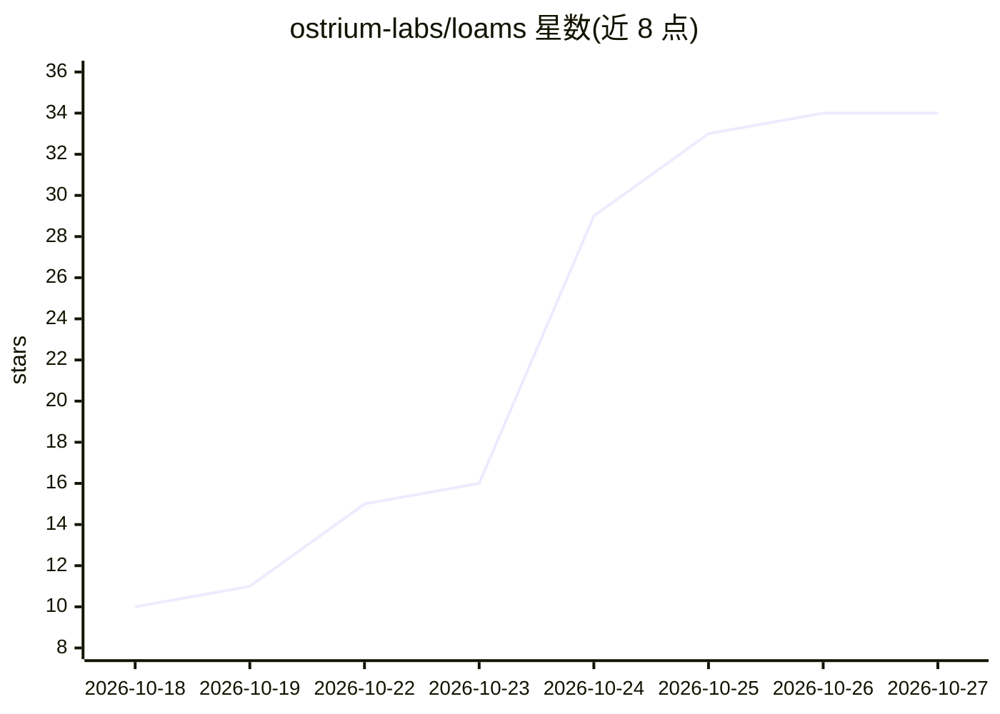

# ostrium-labs/loams

⭐ 34 · Rust · Apache-2.0 · 推送 2026-10-26 · [GitHub](https://github.com/ostrium-labs/loams) · [官网](https://loams.dev) · 组织维护

**开源 AI 原生数据平台：单桶承载混合检索、SQL、图与 agent 运行**

Rust 编写的开源数据平台及其配套产品：以一个引擎运行在用户自有对象存储桶（S3/GCS/Azure Blob/RustFS/本地目录）上，提供向量+BM25+过滤的 RRF 混合检索、兼容 Qdrant/Elasticsearch 客户端与 Arrow Flight SQL 的 API、响应式文档数据库 Live、图数据库 Graph、Postgres/MySQL、ClickHouse 兼容分析与 durable agent 运行。上层产品 Loams Studio 并行运行多个编码 agent CLI（Claude Code、Codex 等），Software Factory 聚合 Forgejo/Zulip 等开发工具链。0.x 阶段，API 与磁盘格式可能变更，通过 Docker Compose 自托管，桌面端提供 Linux/macOS/Windows 版本。

## 筛选速览

| 维度 | 判定 | 备注 |
|---|---|---|
| AI 角色 | `ai-ecosystem` | LLM/agent 周边工具 |
| 许可风险 | `permissive` | Apache-2.0 |
| 部署形态 | `self-host` | docker 或自建部署 |
| 模型依赖 | — | README 未给出锁定关系 |
| 硬件要求 | — | 无带数字的原话,不猜 |
| 安装摩擦 | `low` | 无编译、无系统依赖或容器化 |
| 成熟度 | `idea` | |

## 能力要点

- 单引擎单桶替代检索/图/SQL/流多集群架构，数据存于用户自有对象存储
- 向量、BM25 与过滤经 RRF 融合在一个 DataFusion 查询中
- Qdrant 与 Elasticsearch 客户端免改直接使用，含 Arrow Flight SQL
- Loams Studio 并行运行编码 agent CLI，各线程独立 git worktree，含监督审批与检查点
- 七种语言 SDK 发布至 npm/PyPI/crates.io/NuGet/Go proxy

## 适用场景

- 用自己的对象存储桶替换 Qdrant+Elasticsearch+图数据库等多套有状态集群
- 搭建 AI 应用的一体化检索与持久化后端，客户端代码不改
- 并行运行多个编码 agent 并对比合并结果
- 把开发工具链（代码托管、IM、监控）与 agent 环境放在一起自托管

## 场景标签

`向量数据库` · 领域:知识与检索

## 证据(README 行号)

> L9: Loams is open-source tooling for building software with AI agents: **Loams Studio** runs your coding agents side by 
> L25: Underneath the products is the data platform. A typical AI application runs Elasticsearch, Qdrant, a graph database
> L30: - **Drop-in APIs.** Existing Qdrant and Elasticsearch clients (and LangChain and LlamaIndex on top of them) work un

## 星数曲线

2026-10-18 10 → 2026-10-27 34（+24）

---
*卡片 v1 · prompt 1.4 · 生成 2026-10-25 · 置信度 mid · 依据 README sha `ec01cf8cca03` · [字段定义](../../DATASET.md)*
