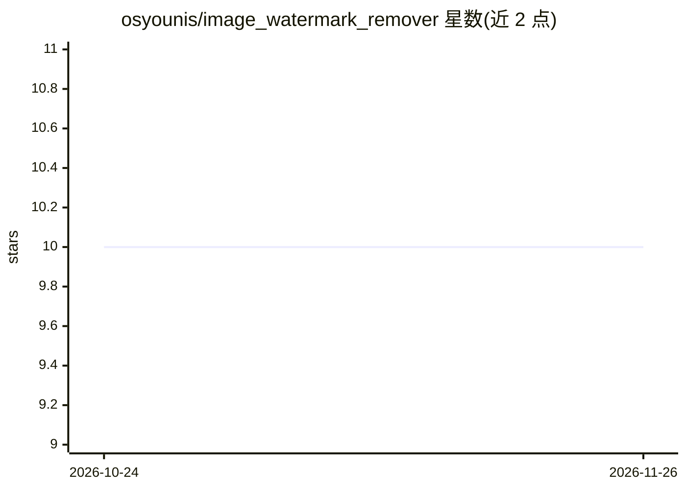

# osyounis/image_watermark_remover

⭐ 10 · Python · MIT · 推送 2026-01-10 · [GitHub](https://github.com/osyounis/image_watermark_remover) · 个人维护

**用 PyTorch 训练 Pix2Pix 模型去除图片水印的项目**

作者以 Unsplash Lite 数据集（25,000 张无水印图片，实际下载约 16,700 张）为基础，为每张图加水印并拼接为成对训练数据，训练 Pix2Pix（U-Net 生成器 + CNN 判别器）实现水印去除。参考 Aladdin Persson 的教程实现，每 5 个 epoch 保存生成器与判别器 checkpoint，每 epoch 保存样本图，并提供 checkpoints 供继续训练。限制：仅训练 25 个 epoch，作者自述水印未能完全去除。

## 筛选速览

| 维度 | 判定 | 备注 |
|---|---|---|
| AI 角色 | `ai-native` | 本体是模型或模型工具 |
| 许可风险 | `permissive` | MIT |
| 部署形态 | `None` |  |
| 模型依赖 | — | README 未给出锁定关系 |
| 硬件要求 | — | 无带数字的原话,不猜 |
| 安装摩擦 | `low` | 无编译、无系统依赖或容器化 |
| 成熟度 | — | 结构信号不足 |

## 能力要点

- 基于 Pix2Pix（U-Net 生成器 + CNN 判别器）的水印去除模型实现
- 自动生成成对训练数据：为无水印图片添加随机文本水印
- 每 5 个 epoch 保存 checkpoint，附带已训练 checkpoints 可继续训练
- settings.py 可调整训练参数

## 适用场景

- 参考图像到图像翻译 GAN 的训练流程与数据构造方法
- 基于已有 checkpoint 继续训练水印去除模型
- 学习 Unsplash 数据集的采集与预处理流程

## 场景标签

`图像视频处理` · 领域:感知与多模态

## 证据(README 行号)

> L5: Many images on the internet contain watermarks, but sometimes you want the image without the watermark. In this proj
> L27: Next I created a Dataset class in dataset.py file. This class is how I load the data into my model. The class also 

## 星数曲线

2026-10-24 10 → 2026-11-26 10（+0）

---
*卡片 v1 · prompt 1.4 · 生成 2026-11-19 · 置信度 high · 依据 README sha `395961ce08bc` · [字段定义](../../DATASET.md)*
