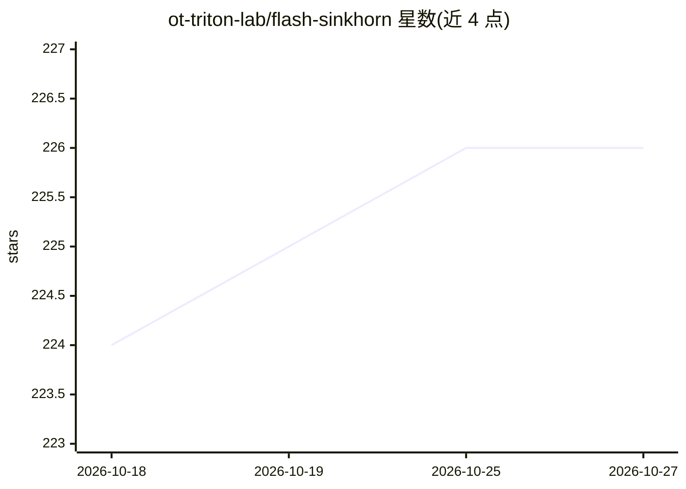

# ot-triton-lab/flash-sinkhorn

⭐ 226 · Python · MIT · 推送 2026-10-05 · [GitHub](https://github.com/ot-triton-lab/flash-sinkhorn) · [官网](https://arxiv.org/abs/2602.03067) · 组织维护

**面向 GPU 的熵正则最优传输库，无需存储成对代价矩阵**

基于 PyTorch + Triton 的熵正则最优传输（Sinkhorn）计算库：提供流式核与 FlashSinkhorn 2 的多尺度块稀疏方法，支持平衡与松弛边缘分布 OT、梯度、Hessian-向量积和传输计划应用，不存储成对代价矩阵以降低显存占用。以 pip 包形式提供，另可通过 Hugging Face Kernels Hub 加载，附 15 个示例 notebook。要求 Python ≥3.9、PyTorch ≥2.5、Triton ≥3.1 与 NVIDIA CUDA GPU；多尺度后端目前仅返回前向代价和势函数，无梯度，且默认 TF32 坐标舍入会保留 FP32 舍入误差。有 ICML 2026 论文。

## 筛选速览

| 维度 | 判定 | 备注 |
|---|---|---|
| AI 角色 | `ai-ecosystem` | LLM/agent 周边工具 |
| 许可风险 | `permissive` | MIT |
| 部署形态 | `library` | 以包/库形式分发 |
| 模型依赖 | — | README 未给出锁定关系 |
| 硬件要求 | — | 无带数字的原话,不猜 |
| 安装摩擦 | `medium` | 含编译或系统依赖之一 |
| 成熟度 | — | 结构信号不足 |

## 能力要点

- 流式 Sinkhorn 核避免存储成对代价矩阵
- 支持梯度、Hessian-向量积、松弛边缘与传输计划应用
- 多尺度块稀疏后端处理大规模点云
- 可通过 Hugging Face Kernels Hub 加载

## 适用场景

- 在大规模点云上计算可微的最优传输损失
- 梯度流、嵌入对齐等需要 OT 损失的训练任务
- 通过 notebook 学习与验证 Sinkhorn 参数选择

## 场景标签

 · 领域:机器学习/最优传输

## 证据(README 行号)

> L11: **Entropic optimal transport in PyTorch + Triton, without storing the pairwise cost matrix.**
> L13: This package provides the streaming kernels of FlashSinkhorn
> L15: Dense backends support balanced and relaxed-marginal OT, gradients, supported Hessian-vector products,

## 星数曲线

2026-10-18 224 → 2026-10-27 226（+2）

---
*卡片 v1 · prompt 1.4 · 生成 2026-10-22 · 置信度 mid · 依据 README sha `95d64f99f33d` · [字段定义](../../DATASET.md)*
