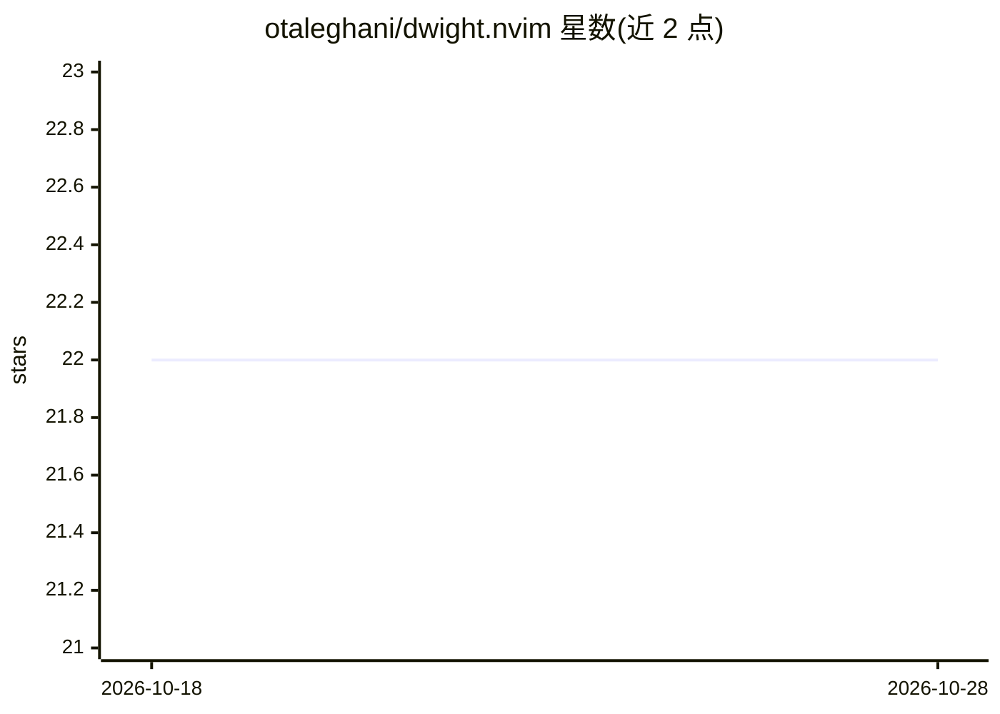

# otaleghani/dwight.nvim

⭐ 22 · Lua · 推送 2026-03-24 · [GitHub](https://github.com/otaleghani/dwight.nvim) · [官网](https://dwight.talesign.com) · 个人维护

**在 Neovim 内编排 AI agent 完成编码任务的自定义助手插件**

面向 Neovim 用户的 AI 编码助手插件：在编辑器内编排 AI agent 进行规划、构建、测试与交付代码；通过 feature pragma 限定工作范围，将多步任务委托给带验证环节的自主 agent，并支持项目本地 skills 与上下文感知生成。以 Neovim/Lua 插件形式提供，具体安装与使用细节需查阅其文档。README 信息有限，关键机制细节（支持的模型后端、命令列表）未在可见范围内给出。

## 筛选速览

| 维度 | 判定 | 备注 |
|---|---|---|
| AI 角色 | `ai-native` | 本体是模型或模型工具 |
| 许可风险 | `none` | — |
| 部署形态 | `None` |  |
| 模型依赖 | — | README 未给出锁定关系 |
| 硬件要求 | — | 无带数字的原话,不猜 |
| 安装摩擦 | `low` | 无编译、无系统依赖或容器化 |
| 成熟度 | — | 结构信号不足 |

## 能力要点

- 在编辑器内编排 AI agent 规划、构建、测试代码
- feature pragma 限定任务作用范围
- 多步任务委托给带验证环节的自主 agent
- 项目本地 skills 与上下文感知生成

## 适用场景

- 不离开 Neovim 完成多步编码任务
- 按 feature 范围约束 AI 修改的影响面
- 通过带验证环节的 agent 委托构建与测试工作

## 场景标签

`编码 Agent` · 领域:编码与开发

## 证据(README 行号)

> L4: > **An AI-powered development companion for Neovim.**
> L10: **Dwight** is a Neovim plugin that orchestrates AI agents to plan, build, test, and ship code — all without leaving

## 星数曲线

2026-10-18 22 → 2026-10-28 22（+0）

---
*卡片 v1 · prompt 1.4 · 生成 2026-10-27 · 置信度 low · 依据 README sha `51517624fd54` · [字段定义](../../DATASET.md)*
