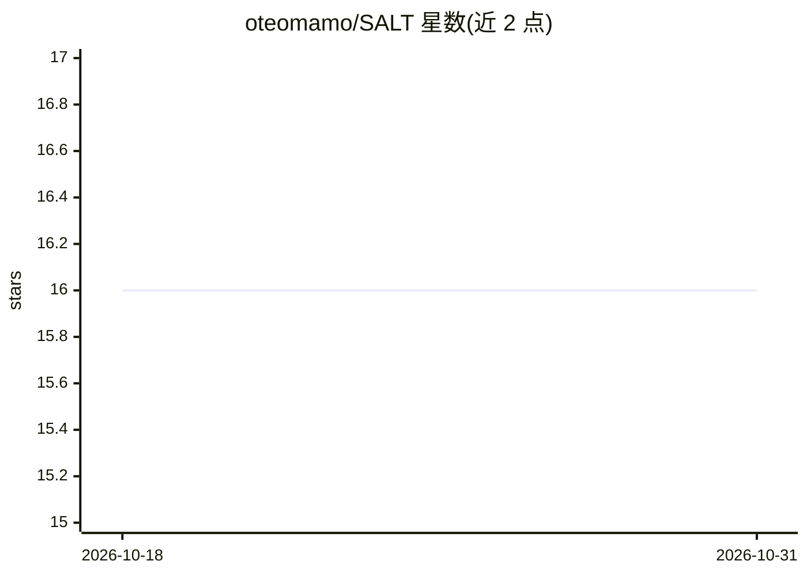

# oteomamo/SALT

⭐ 16 · Python · MIT · 推送 2026-10-25 · [GitHub](https://github.com/oteomamo/SALT) · 组织维护

**长上下文压缩工具：用显著性感知词典树压缩送入 LLM 的提示**

SALT 在长文档送入语言模型前将其压缩到固定 token 预算：先将各句关键词组织为按频次排序的词典树（索引阶段，一次构建可跨轮复用），再把预算分配到各主题分支后选句（选择阶段），以避免主题坍缩。支持一次性压缩 CLI、交互式聊天 saltChat、持久服务 saltServe 与 MCP 服务器。安装需 Python 3.10，GPU 路径需 CUDA 12.8 与 NVIDIA 驱动 570+，CPU 亦可运行压缩。EMNLP 2026 主会论文。

## 筛选速览

| 维度 | 判定 | 备注 |
|---|---|---|
| AI 角色 | `ai-ecosystem` | LLM/agent 周边工具 |
| 许可风险 | `permissive` | MIT |
| 部署形态 | `library` | 以包/库形式分发 |
| 模型依赖 | local-ok | 支持本地模型 |
| 硬件要求 | — | 无带数字的原话,不猜 |
| 安装摩擦 | `medium` | 含编译或系统依赖之一 |
| 成熟度 | `idea` | |

## 能力要点

- 词典树索引一次构建、跨轮次与预算复用
- 预算按主题分支分配，缓解主题坍缩
- 四个控制台命令：salt/saltChat/saltServe/salt-mcp
- 可选 vLLM 后端（前缀缓存/持久服务）

## 适用场景

- 长文档问答前压缩提示以降低计算与等待成本
- 多轮对话中作为持久会话记忆压缩历史
- 在 LongBench 等长上下文基准上压缩并评测

## 场景标签

`Agent 记忆` · 领域:Agent 开发

## 证据(README 行号)

> L18: SALT shrinks a long document down to a fixed size before it is sent to a language
> L19: model, keeping the sentences that carry the most information. It works with any
> L50: Two phases. **Indexing** reads the document once and builds a keyword trie - a

## 星数曲线

2026-10-18 16 → 2026-10-31 16（+0）

---
*卡片 v1 · prompt 1.4 · 生成 2026-10-30 · 置信度 high · 依据 README sha `903ce8ffaf86` · [字段定义](../../DATASET.md)*
