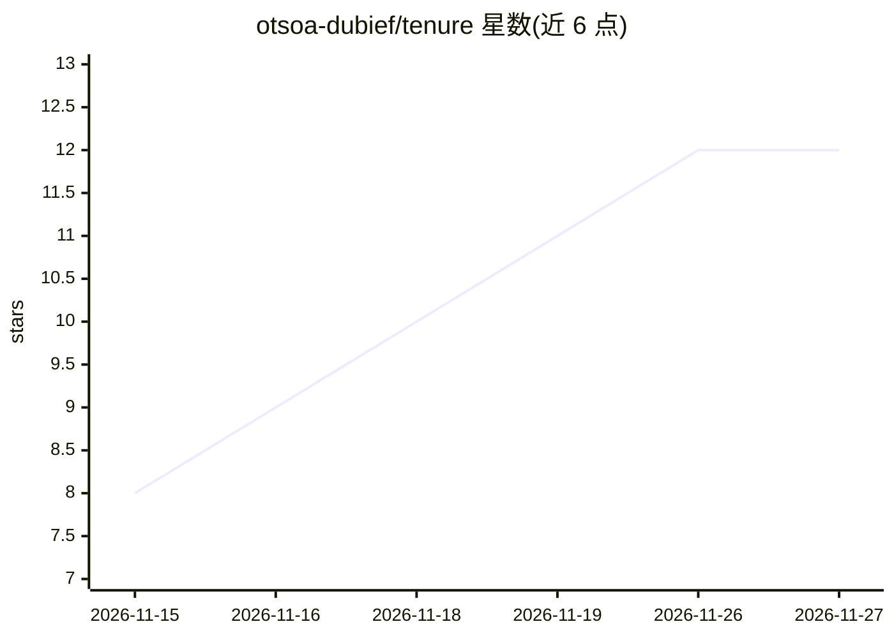

# otsoa-dubief/tenure

⭐ 12 · Python · Apache-2.0 · 推送 2026-11-22 · [GitHub](https://github.com/otsoa-dubief/tenure) · [官网](https://hermes-agent.nousresearch.com/marketplace/tenure) · 个人维护 · 中文 README

**为 Hermes agent 提供可撤销信任与自治分级管理**

tenure 是 Hermes Agent 的插件，按动作类型管理代理的自治程度：默认信任时日常操作（文件、内存、npm/python/git 等开发工具）不追加提问，写入文件保存副本并支持 24 小时内撤销；出现撤销、标记或校验失败后，该类动作降入 T1（先询问），可经审批在两次会话的验证成功序列后升回 T3（自主执行）。附签名自治护照与可重放账本、桌面页面与仪表盘标签，支持 5 种语言。要求 Hermes 0.23+ 与 Python 3.11+。

## 筛选速览

| 维度 | 判定 | 备注 |
|---|---|---|
| AI 角色 | `ai-ecosystem` | LLM/agent 周边工具 |
| 许可风险 | `permissive` | Apache-2.0 |
| 部署形态 | `None` |  |
| 模型依赖 | — | README 未给出锁定关系 |
| 硬件要求 | — | 无带数字的原话,不猜 |
| 安装摩擦 | `low` | 无编译、无系统依赖或容器化 |
| 成熟度 | — | 结构信号不足 |

## 能力要点

- 按动作类型的三级信任阶梯（Trusted/T1/T2/T3），单类失误只降该类
- 写入文件保存副本并支持 24 小时撤销（/tenure undo）
- ED25519 签名自治护照，可对导出账本重放校验（hermes tenure verify）
- 无网络调用、无 LLM 调用，支持 5 种界面语言

## 适用场景

- 让 Hermes agent 日常开发操作不被反复打断，同时保留撤销能力
- agent 出错后自动限制同类动作并要求人工审批
- 对多模型代理按风险等级管理自治权限并留存可核查证据

## 场景标签

`LLM 可观测性` · 领域:评测与运维

## 证据(README 行号)

> L5:  A plugin for Hermes Agent. No extra question for everyday
> L93: hermes plugins install otsoa-dubief/tenure/tenure   # once listed in the catalog: hermes plugins install tenure
> L98: Requires Hermes 0.23.0 or later and Python 3.11 or later. No network, no LLM call, nothing to configure to start.

## 星数曲线

2026-11-15 8 → 2026-11-27 12（+4）

---
*卡片 v1 · prompt 1.4 · 生成 2026-11-19 · 置信度 high · 依据 README sha `befcd920eaa7` · [字段定义](../../DATASET.md)*
