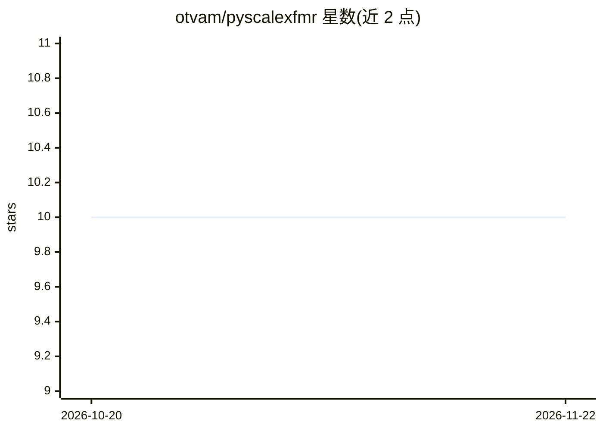

# otvam/pyscalexfmr

⭐ 10 · Python · MPL-2.0 · 推送 2026-01-13 · [GitHub](https://github.com/otvam/pyscalexfmr) · 组织维护

**为电力电子研究者提供中频变压器建模、优化与缩放定律的开源代码**

IEEE ICRERA 2025 论文的配套源码，实现单相/三相、壳型/芯型中频变压器模型，计入高频铁芯与绕组损耗及非正弦波形影响；提供解析最优点与差分进化数值优化两类方法，以及频率敏感性、绕组材料、功率/体积等缩放定律的计算脚本。以 Python 包与脚本形式组织，附论文 PDF 与参数 JSON 数据，经 Linux x86/64 与 Python 3.12.3 测试，MPL-2.0 许可。

## 筛选速览

| 维度 | 判定 | 备注 |
|---|---|---|
| AI 角色 | `ai-knowledge` | 知识聚合/清单类 |
| 许可风险 | `permissive` | MPL-2.0 |
| 部署形态 | `None` |  |
| 模型依赖 | — | README 未给出锁定关系 |
| 硬件要求 | — | 无带数字的原话,不猜 |
| 安装摩擦 | `low` | 无编译、无系统依赖或容器化 |
| 成熟度 | — | 结构信号不足 |

## 能力要点

- 单相/三相、壳型/芯型中频变压器模型，含高频损耗与非正弦波形影响
- 解析最优与差分进化数值优化两种方法
- 频率敏感性、绕组材料、功率/体积等系列缩放定律脚本
- 提供论文 PDF 与生成的参数 JSON 数据

## 适用场景

- 为 DAB/SRC DC/DC 变换器设计计算中频变压器方案
- 对比单相与三相、不同绕组材料的变压器缩放特性
- 复现论文中的效率与功率密度分析结果

## 场景标签

 · 领域:电力电子/科研工程

## 证据(README 行号)

> L5: This repository contains the **source code** related to the following **paper**:
> L12: This code implements simple **medium-frequency transformer models**:
> L19: This code implements several **optimization methods**:

## 星数曲线

2026-10-20 10 → 2026-11-22 10（+0）

---
*卡片 v1 · prompt 1.4 · 生成 2026-11-19 · 置信度 high · 依据 README sha `2c1eadcb559d` · [字段定义](../../DATASET.md)*
