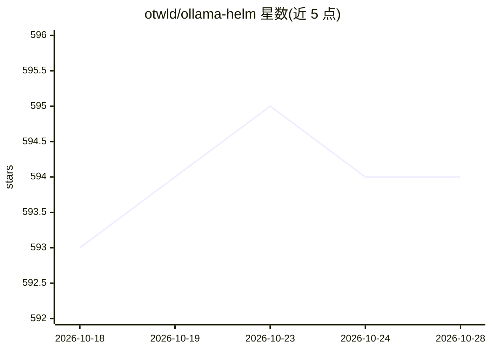

# otwld/ollama-helm

⭐ 595 · Go Template · MIT · 推送 2026-10-28 · [GitHub](https://github.com/otwld/ollama-helm) · [官网](https://artifacthub.io/packages/helm/ollama-helm/ollama) · 组织维护

**在 Kubernetes 上部署 Ollama 的社区 Helm chart**

OTWLD 维护的社区 Helm chart，用于在 Kubernetes 集群中部署 Ollama 本地大模型运行时。支持 GPU（NVIDIA/AMD，含 MIG 与 DRA）、启动时拉取/加载/创建模型、Ingress/Gateway API/Knative 部署模式、自动扩缩容与持久卷。要求 Kubernetes >=1.16（CPU）或 >=1.26（GPU 稳定支持）。通过 helm repo add/install 安装，values.yaml 提供大量配置项。注意并非所有 GPU（尤其 AMD）均被 Ollama 支持。

## 筛选速览

| 维度 | 判定 | 备注 |
|---|---|---|
| AI 角色 | `ai-ecosystem` | LLM/agent 周边工具 |
| 许可风险 | `permissive` | MIT |
| 部署形态 | `self-host` | docker 或自建部署 |
| 模型依赖 | local-ok | 支持本地模型 |
| 硬件要求 | `cpu-ok` | |
| 安装摩擦 | `low` | 无编译、无系统依赖或容器化 |
| 成熟度 | — | 结构信号不足 |

## 能力要点

- 启动时自动 pull/run/create 模型，支持从 ConfigMap 加载模型模板
- NVIDIA/AMD GPU 集成，含 MIG 切片与 DRA 资源声明支持
- 可选 Knative Serverless 部署模式（非阻塞 bootstrap Job）
- 支持 Ingress、Gateway API HTTPRoute 与自动扩缩容

## 适用场景

- 在 Kubernetes 集群中运行 Ollama 并配置 GPU 调度
- 通过 Ingress/Gateway 将 Ollama API 暴露给外部客户端
- 以声明式 values 管理模型预拉取与自动清理

## 场景标签

 · 领域:LLM 基础设施/容器编排

## 证据(README 行号)

> L10: This Community Chart is for deploying Ollama.
> L32: helm install ollama otwld/ollama --namespace ollama --create-namespace

## 星数曲线

2026-10-18 593 → 2026-10-28 594（+1）

---
*卡片 v1 · prompt 1.4 · 生成 2026-10-21 · 置信度 mid · 依据 README sha `6591ac8aa9dd` · [字段定义](../../DATASET.md)*
