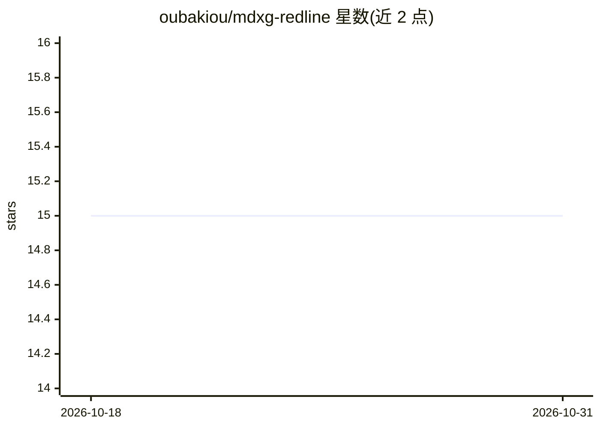

# oubakiou/mdxg-redline

⭐ 15 · TypeScript · MIT · 推送 2026-08-11 · [GitHub](https://github.com/oubakiou/mdxg-redline) · 个人维护

**Markdown 人工批注工具：把行内评论导出为 LLM 可读 JSON**

浏览器中运行的单 HTML 文件 Markdown 审阅工具：阅读者选中任意文本范围添加行内评论，导出的 JSON 中以 headingPath 与 sourceLine 定位每条评论。提供在线版（mkdn.review）、可自托管的静态版、独立 HTML 文件与 npx CLI 四种使用途径。CLI 生成的 review.html 与反馈 feedback.json 按文档哈希配对，LLM agent 可通过 md-review 技能调用 CLI，与人工审阅者往返传递 Markdown。渲染层符合 MDXG Viewer 规范（预览阶段规范），支持 Shiki 语法高亮、Mermaid、KaTeX 数学公式。写出 feedback.json 依赖 File System Access API，仅 Chromium 系浏览器支持。

## 筛选速览

| 维度 | 判定 | 备注 |
|---|---|---|
| AI 角色 | `ai-ecosystem` | LLM/agent 周边工具 |
| 许可风险 | `permissive` | MIT |
| 部署形态 | `desktop` | 安装包/桌面程序 |
| 模型依赖 | — | README 未给出锁定关系 |
| 硬件要求 | — | 无带数字的原话,不猜 |
| 安装摩擦 | `low` | 无编译、无系统依赖或容器化 |
| 成熟度 | — | 结构信号不足 |

## 能力要点

- 行内评论导出为含 headingPath 与 sourceLine 定位的结构化 JSON
- LLM agent 可通过 md-review 技能调用 CLI，与审阅者往返协作
- 独立 HTML / CLI 构建完全本地运行，不上传文档与评论
- 支持 Shiki 语法高亮（约 235 种语法）、Mermaid、KaTeX 数学渲染

## 适用场景

- 对 AI 生成的 Markdown 文档做人工审阅并把反馈交给 agent 修改
- 在本地无安装条件下快速批注 Markdown 草稿
- 自托管静态站点供团队做 Markdown 在线审阅

## 场景标签

 · 领域:开发工具/文档审阅

## 证据(README 行号)

> L9: **Select any range in Markdown, leave inline comments, and turn a human's review into structured JSON an LLM can pro
> L81: An LLM agent (e.g. Claude Code) invokes this CLI through the `md-review` skill, ping-ponging markdown between the a

## 星数曲线

2026-10-18 15 → 2026-10-31 15（+0）

---
*卡片 v1 · prompt 1.4 · 生成 2026-10-30 · 置信度 high · 依据 README sha `6734b03bfdc6` · [字段定义](../../DATASET.md)*
