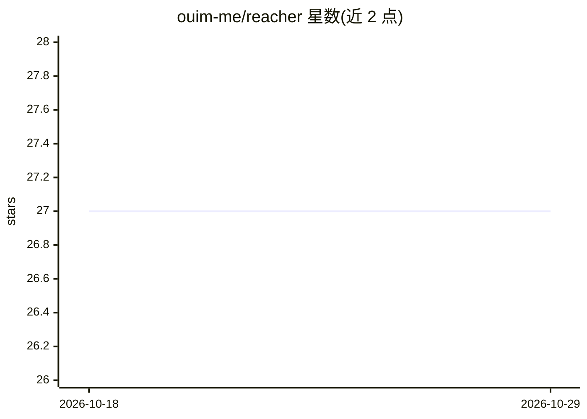

# ouim-me/reacher

⭐ 27 · JavaScript · MIT · 推送 2026-04-01 · [GitHub](https://github.com/ouim-me/reacher) · [官网](https://docs.ouim.me/reacher/introduction) · 个人维护

**自托管 MCP 服务器：让 Claude 安全访问你的 API、浏览器、SSH 与记忆**

面向 Claude 用户的自托管 MCP 连接器，运行在自己控制的基础设施上。核心工具包括：fetch_external 将任意 HTTP 请求代理到白名单域名并自动注入认证令牌、browser 通过 CDP 控制无头浏览器、gist_kb 基于 GitHub Gist 的持久知识库、ssh_exec 在 Tailscale 网络内机器上执行命令。服务器只注册有凭据的工具，无对应令牌则对应工具不加载。配置基于环境变量与 reacher.config.yaml，需 Node.js。

## 筛选速览

| 维度 | 判定 | 备注 |
|---|---|---|
| AI 角色 | `ai-ecosystem` | LLM/agent 周边工具 |
| 许可风险 | `permissive` | MIT |
| 部署形态 | `None` |  |
| 模型依赖 | locked-api |  |
| 硬件要求 | — | 无带数字的原话,不猜 |
| 安装摩擦 | `low` | 无编译、无系统依赖或容器化 |
| 成熟度 | — | 结构信号不足 |

## 能力要点

- fetch_external 单工具代理任意白名单域名的 HTTP 请求并自动注入令牌
- 基于 GitHub Gist 的跨会话持久知识库
- 通过 CDP 控制无头浏览器，支持抓取/点击/填表/快照
- Tailscale 网格内 SSH 执行与设备状态查询

## 适用场景

- 让 Claude 在不泄露凭据的前提下调用我的 GitHub/Linear/Notion API
- 让 Claude 记住知识库与设备拓扑，跨会话持久保留
- 让 Claude SSH 到我自己网络里的服务器执行运维操作

## 场景标签

`浏览器自动化` `Agent 记忆` · 领域:Agent 开发

## 证据(README 行号)

> L3: Give Claude authenticated access to your APIs, a persistent knowledge base, a headless browser, and optionally your 
> L15: Most MCP connectors give you one tool per API action. Reacher's `fetch_external` tool takes a different approach: i
> L46: |`fetch_external`|Proxy HTTP requests to allowlisted domains with automatic auth injection|

## 星数曲线

2026-10-18 27 → 2026-10-29 27（+0）

---
*卡片 v1 · prompt 1.4 · 生成 2026-10-26 · 置信度 high · 依据 README sha `09c994cc0f2d` · [字段定义](../../DATASET.md)*
