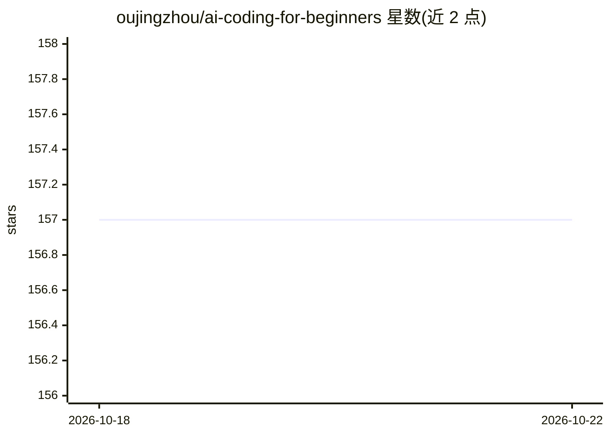

# oujingzhou/ai-coding-for-beginners

⭐ 157 · 推送 2026-03-02 · [GitHub](https://github.com/oujingzhou/ai-coding-for-beginners) · 个人维护 · 中文 README

**Stanford CS146S 现代 AI 软件开发中文教程**

基于 Stanford University CS146S 课程整理的中文学习教程：讲解大语言模型时代的软件开发范式，覆盖编程 LLM 入门、编程智能体架构、AI IDE、智能体模式、AI 测试与安全、Agent 运维等 10 章，配学习资料与幻灯片链接。课程强调 Human-agent engineering，即工程师作为 AI 的管理者需审查代码、理解优秀软件。提供学习检查清单与资源汇总，面向想系统学习 AI 辅助软件工程的学生与开发者。

## 筛选速览

| 维度 | 判定 | 备注 |
|---|---|---|
| AI 角色 | `ai-knowledge` | 知识聚合/清单类 |
| 许可风险 | `none` | — |
| 部署形态 | `None` |  |
| 模型依赖 | — | README 未给出锁定关系 |
| 硬件要求 | — | 无带数字的原话,不猜 |
| 安装摩擦 | `low` | 无编译、无系统依赖或容器化 |
| 成熟度 | — | 结构信号不足 |

## 能力要点

- 10 章课程结构，覆盖智能体架构、AI IDE、测试安全、运维
- 强调 Human-agent engineering：人类作为 AI 管理者与决策者
- 多语言版本（英语/日语/中文）与学习检查清单

## 适用场景

- 系统学习 AI 时代的软件开发流程与工具
- 跟随 Stanford CS146S 课程获取学习资料与幻灯片
- 了解编程智能体的架构与工作模式

## 场景标签

 · 领域:软件工程教育/AI 编程

## 证据(README 行号)

> L9: 近年来，大语言模型为软件开发引入了革命性的新范式。传统的软件开发生命周期正在各个阶段被 AI 自动化所改变，这引发了一个问题：下一代软件工程师应该如何工作？
> L15: ## 课程概览

## 星数曲线

2026-10-18 157 → 2026-10-22 157（+0）

---
*卡片 v1 · prompt 1.4 · 生成 2026-10-22 · 置信度 high · 依据 README sha `b6a55f3a1430` · [字段定义](../../DATASET.md)*
