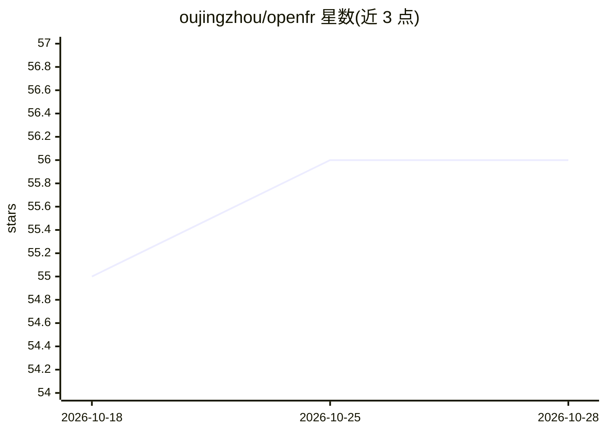

# oujingzhou/openfr

⭐ 56 · Python · 推送 2026-05-09 · [GitHub](https://github.com/oujingzhou/openfr) · 组织维护 · 中文 README

**面向个人投资者的多智能体金融研究 CLI 工具**

基于大模型与 AKShare 数据接口的金融研究 Agent，用 LangGraph StateGraph 编排三阶段多智能体流程：四类分析师、牛熊辩论、三方风险评估，输出评级（买入到卖出）、置信度、推理与操作建议。通过 Typer CLI 提供交互对话与单次查询，覆盖 A 股、港股、基金、期货、指数、宏观等 35+ 数据工具，支持 15+ LLM 提供商（默认智谱 GLM）。多智能体模式至少约 15 次串行 LLM 调用，耗时依赖模型延迟；部分实时数据仅交易时段可用。

## 筛选速览

| 维度 | 判定 | 备注 |
|---|---|---|
| AI 角色 | `ai-native` | 本体是模型或模型工具 |
| 许可风险 | `none` | — |
| 部署形态 | `None` |  |
| 模型依赖 | local-ok | 支持本地模型 |
| 硬件要求 | — | 无带数字的原话,不猜 |
| 安装摩擦 | `low` | 无编译、无系统依赖或容器化 |
| 成熟度 | — | 结构信号不足 |

## 能力要点

- LangGraph 编排的多智能体流程：四分析师+牛熊辩论+三方风险评估
- 35+ 金融数据工具，覆盖 A 股/港股/基金/期货/指数/宏观
- 15+ LLM 提供商可选，兼容 OpenAI 与 Anthropic 格式
- 东方财富/新浪/同花顺多数据源自动重试与降级

## 适用场景

- 在终端对话式查询个股行情并获取投资分析
- 生成包含评级、置信度与风险辩论的研究报告
- 分析当日热门板块、宏观指标等市场信息

## 场景标签

`金融量化` `多智能体` · 领域:Agent 开发

## 证据(README 行号)

> L11: OpenFR (Open Financial Research) is a **minimal, lightweight** intelligent financial research Agent. Built on large
> L16: - 🧠 **Multi-Agent Collaboration** — Four analysts + bull/bear debate + three-way risk assessment, orchestrated via 
> L38: - Rating: Buy / Overweight / Hold / Underweight / Sell

## 星数曲线

2026-10-18 55 → 2026-10-28 56（+1）

---
*卡片 v1 · prompt 1.4 · 生成 2026-10-24 · 置信度 high · 依据 README sha `348376fe8bc5` · [字段定义](../../DATASET.md)*
