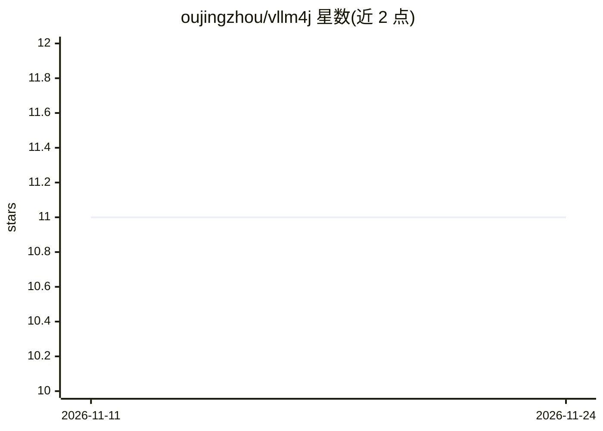

# oujingzhou/vllm4j

⭐ 11 · Java · 推送 2026-07-15 · [GitHub](https://github.com/oujingzhou/vllm4j) · 个人维护 · 中文 README

**Java 开发者的最小化 LLM 推理引擎（CPU 运行）**

用约 1.5K 行 Java 实现的 LLM 推理引擎，实现现代推理服务系统的核心机制：分页 KV cache、prefix caching、continuous batching、chunked prefill 与 recompute 抢占。仅支持 CPU 推理，通过 Java Vector API 做 SIMD 加速；支持 Qwen3 dense 模型，并与 HuggingFace transformers 的贪心输出做 token 级精确对比验证。既提供 CLI 生成文本，也可作为 Java 库嵌入使用，要求 Java 21+ 与 Maven 3.9+。

## 筛选速览

| 维度 | 判定 | 备注 |
|---|---|---|
| AI 角色 | `ai-ecosystem` | LLM/agent 周边工具 |
| 许可风险 | `none` | — |
| 部署形态 | `None` |  |
| 模型依赖 | — | README 未给出锁定关系 |
| 硬件要求 | `cpu-ok` | |
| 安装摩擦 | `medium` | 含编译或系统依赖之一 |
| 成熟度 | — | 结构信号不足 |

## 能力要点

- 约 1.5K 行依赖轻量的 Java 实现 PagedAttention、prefix caching、continuous batching 等机制
- CPU-only，通过 Java Vector API 做 SIMD 加速，明确不使用 GPU/CUDA
- 支持 Qwen3 dense 模型，与 HuggingFace transformers 贪心输出 token 精确一致验证
- 提供 CLI 与 Java 库两种使用方式，含流式/动态请求注入与采样种子复现

## 适用场景

- 在无 GPU 的环境用 Java 进程运行 Qwen3 模型生成文本
- 在 Java 服务端应用中嵌入 LLM 推理循环
- 学习推理服务系统中 batching、KV cache 与抢占机制的实现

## 场景标签

`推理引擎` · 领域:训练与推理

## 证据(README 行号)

> L5: A minimal Java LLM inference engine implementing the core techniques of modern serving systems:
> L7: in ~1.5K lines of dependency-light Java. CPU-only, SIMD-accelerated via the Java Vector API.
> L141: Design notes: CPU-only by design (no GPU/tensor-parallel/CUDA graphs); attention

## 星数曲线

2026-11-11 11 → 2026-11-24 11（+0）

---
*卡片 v1 · prompt 1.4 · 生成 2026-11-18 · 置信度 high · 依据 README sha `b3a1de4658ee` · [字段定义](../../DATASET.md)*
