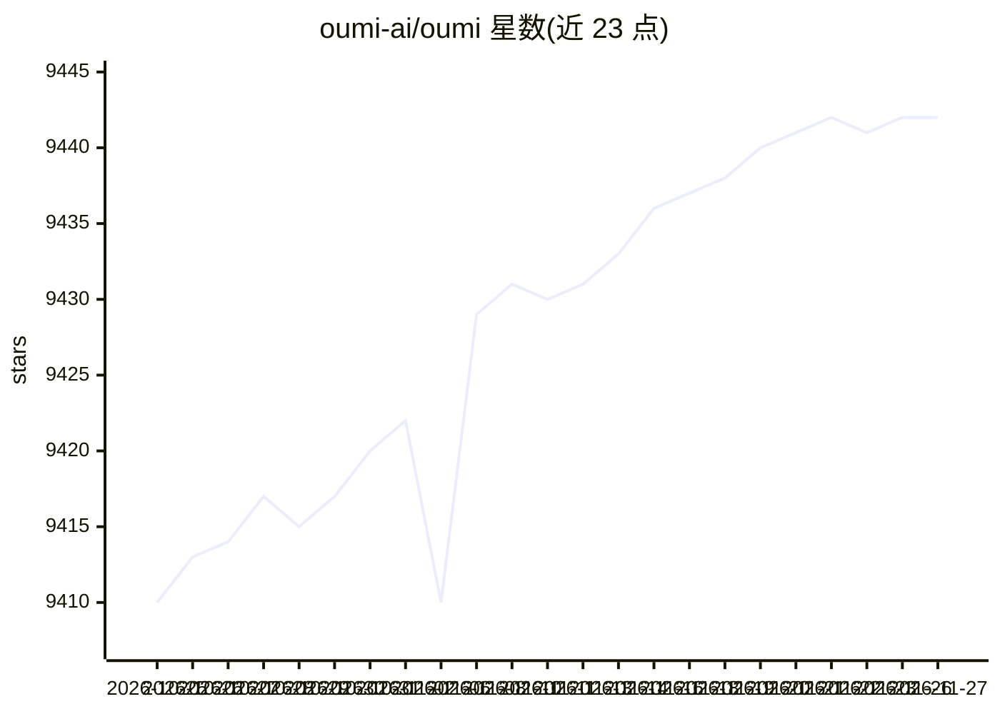

# oumi-ai/oumi

⭐ 9,442 · Python · Apache-2.0 · 推送 2026-11-26 · [GitHub](https://github.com/oumi-ai/oumi) · [官网](https://oumi.ai) · 组织维护

**开源 LLM 全生命周期平台：微调、评估、部署一站完成**

Oumi 是一个开源平台，覆盖基础模型从数据准备、训练微调（SFT/LoRA/QLoRA/DPO/GRPO）到评估与部署的完整流程；支持工具调用的 agentic 模型训练、可执行工具环境与基于 verl 的 GRPO 强化学习，以及数据合成与 LLM-as-a-Judge。可从笔记本运行到云端集群（AWS/Azure/GCP/Lambda/Slurm），通过 oumi CLI、Python API 与 oumi-mcp MCP 服务器使用。README 标注当前为 beta，处于活跃开发中。

## 筛选速览

| 维度 | 判定 | 备注 |
|---|---|---|
| AI 角色 | `ai-ecosystem` | LLM/agent 周边工具 |
| 许可风险 | `permissive` | Apache-2.0 |
| 部署形态 | `self-host` | docker 或自建部署 |
| 模型依赖 | local-ok | 支持本地模型 |
| 硬件要求 | — | 无带数字的原话,不猜 |
| 安装摩擦 | `low` | 无编译、无系统依赖或容器化 |
| 成熟度 | `idea` | |

## 能力要点

- 支持 SFT/LoRA/QLoRA/DPO/GRPO 等微调方法，模型规模 10M 至 400B+ 参数
- agentic 模型训练：tool-calling SFT、可执行工具环境与 verl GRPO 强化学习
- 支持文本与多模态模型（Llama、Gemma、Qwen、DeepSeek 等）
- 提供 oumi deploy 端点部署与 oumi-mcp MCP 服务器

## 适用场景

- 为自有任务微调开源 LLM/VLM 并评估效果
- 训练带工具调用能力的 agentic 模型
- 在云平台批量启动和监控远程训练任务
- 用 LLM-as-a-Judge 过滤和合成训练数据

## 场景标签

`微调` `模型评测` `强化学习` · 领域:评测与运维

## 证据(README 行号)

> L62: Oumi is a fully open-source platform that streamlines the entire lifecycle of foundation models - from data prepara
> L66: - 🚀 Train and fine-tune models from 10M to 400B+ parameters using state-of-the-art techniques (SFT, LoRA, QLoRA, DP
> L153: **Note:** Oumi is in <ins>beta</ins> and under active development. The core features are stable, but some advanced

## 星数曲线

2026-10-25 9,410 → 2026-11-27 9,442（+32）

---
*卡片 v1 · prompt 1.4 · 生成 2026-11-22 · 置信度 high · 依据 README sha `66eae6627228` · [字段定义](../../DATASET.md)*
