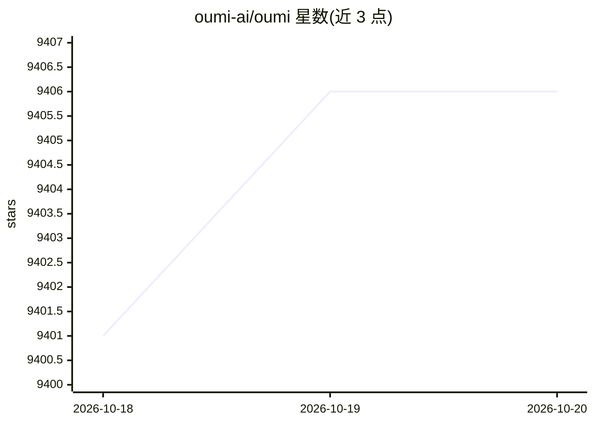

# oumi-ai/oumi

⭐ 9,406 · Python · Apache-2.0 · 推送 2026-10-19 · [GitHub](https://github.com/oumi-ai/oumi) · [官网](https://oumi.ai) · 组织维护

**开源基础模型全流程平台：微调、评测与部署 LLM/VLM**

Oumi 是覆盖基础模型全生命周期的开源 Python 平台：数据合成与整理、SFT/LoRA/QLoRA/DPO/GRPO 训练（10M 至 400B+ 参数）、LLM-as-a-Judge 与基准评测、以及基于 vLLM/SGLang 的推理服务或 oumi deploy 端点部署。提供 CLI、现成模型配方（Qwen/Gemma/Llama/DeepSeek/gpt-oss 等）、Docker 镜像与云端任务启动（AWS/Azure/GCP/Lambda 等）。README 声明处于 beta 阶段，核心功能稳定但部分高级功能可能变化。

## 筛选速览

| 维度 | 判定 | 备注 |
|---|---|---|
| AI 角色 | `ai-ecosystem` | LLM/agent 周边工具 |
| 许可风险 | `permissive` | Apache-2.0 |
| 部署形态 | `self-host` | docker 或自建部署 |
| 模型依赖 | local-ok | 支持本地模型 |
| 硬件要求 | — | 无带数字的原话,不猜 |
| 安装摩擦 | `low` | 无编译、无系统依赖或容器化 |
| 成熟度 | `idea` | |

## 能力要点

- 支持 SFT/LoRA/QLoRA/DPO/GRPO 等训练技术，含工具调用与可执行工具环境
- 数据合成与 LLM-as-a-Judge 多准则评测
- vLLM/SGLang 推理引擎与 oumi deploy 专用端点部署
- oumi launch 在 AWS/Azure/GCP/Lambda/Slurm 等平台远程运行任务

## 适用场景

- 对开源 LLM/VLM 做 LoRA 微调并评测
- 用 GRPO 与工具环境训练 agentic 模型
- 用 LLM judge 合成和整理训练数据
- 把微调后的模型部署到推理端点

## 场景标签

`微调` `强化学习` `模型评测` `推理引擎` · 领域:评测与运维

## 证据(README 行号)

> L62: Oumi is a fully open-source platform that streamlines the entire lifecycle of foundation models - from data prepara
> L66: - 🚀 Train and fine-tune models from 10M to 400B+ parameters using state-of-the-art techniques (SFT, LoRA, QLoRA, DP
> L70: - ⚡️ Serve models efficiently with popular inference engines (vLLM, SGLang), or deploy to dedicated endpoints with 

## 星数曲线

2026-10-18 9,401 → 2026-10-20 9,406（+5）

---
*卡片 v1 · prompt 1.4 · 生成 2026-10-20 · 置信度 high · 依据 README sha `83b3ab51d472` · [字段定义](../../DATASET.md)*
