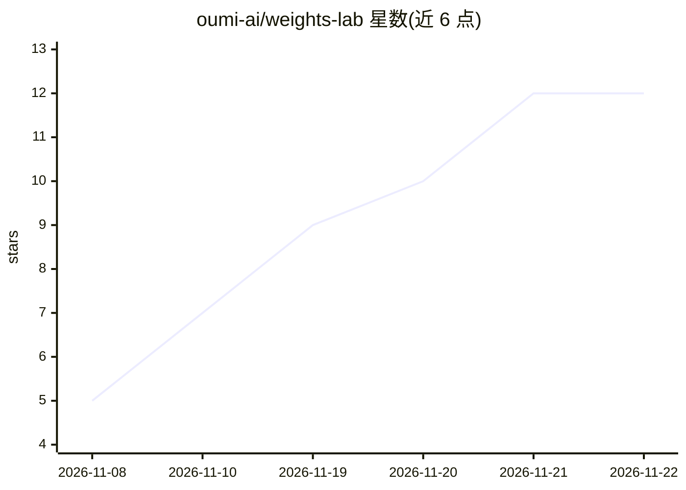

# oumi-ai/weights-lab

⭐ 12 · Python · Apache-2.0 · 推送 2026-11-08 · [GitHub](https://github.com/oumi-ai/weights-lab) · [官网](https://oumi.ai) · 组织维护

**让编码 Agent 以可逆方式编辑开源 LLM 权重的实验技能**

由 agent skill 与 Python CLI（oumi-weights-lab）组成的权重空间实验工具：将开源语言模型一次性加载后，编码 Agent 通过发送 Python 片段直接读写网络权重，支持精确撤销、前向评估、导出与备份，每个片段的来源、输出与前向次数被保存。支持 LoRA 加载、4/8-bit 量化、多 GPU device-map、经 SAELens/TransformerLens 的稀疏自编码器，并可在 SkyPilot/Slurm 上运行远程 worker。版本 0.5 标注为实验性，片段以受信 Python 运行，拥有文件系统与网络访问权限。

## 筛选速览

| 维度 | 判定 | 备注 |
|---|---|---|
| AI 角色 | `ai-ecosystem` | LLM/agent 周边工具 |
| 许可风险 | `permissive` | Apache-2.0 |
| 部署形态 | `None` |  |
| 模型依赖 | — | README 未给出锁定关系 |
| 硬件要求 | — | 无带数字的原话,不猜 |
| 安装摩擦 | `medium` | 含编译或系统依赖之一 |
| 成熟度 | `idea` | |

## 能力要点

- 权重可逆编辑：编辑后可用 undo 精确恢复，模型保持常驻加载
- 支持量化加载（nf4）、LoRA 适配器、多 GPU 与 SAE/transcoder（可选 extras）
- 提供 CLI 直接使用：start/send/stop/backup 会话管理，stdout 为 JSON
- 已在 CPU、Apple MPS、H200、8×H100（72B 模型）及 SkyPilot+Slurm 上测试

## 适用场景

- 让 Claude Code/Codex/Cursor 等 Agent 对开源模型做消融与权重干预实验
- 复现已发布的权重空间编辑并在基准上验证效果
- 加载 SAE 并研究模型内部机制（机制可解释性实验）

## 场景标签

`科研工具` · 领域:学习与行业

## 证据(README 行号)

> L11: An agent skill and Python worker that let your coding agent experiment on an open
> L16: network's weights directly instead of relying on an optimizer such as gradient
> L62: Then ask your agent, for example: "Use oumi-weights-lab to check whether zeroing

## 星数曲线

2026-11-08 5 → 2026-11-22 12（+7）

---
*卡片 v1 · prompt 1.4 · 生成 2026-11-20 · 置信度 high · 依据 README sha `614e380d7af2` · [字段定义](../../DATASET.md)*
