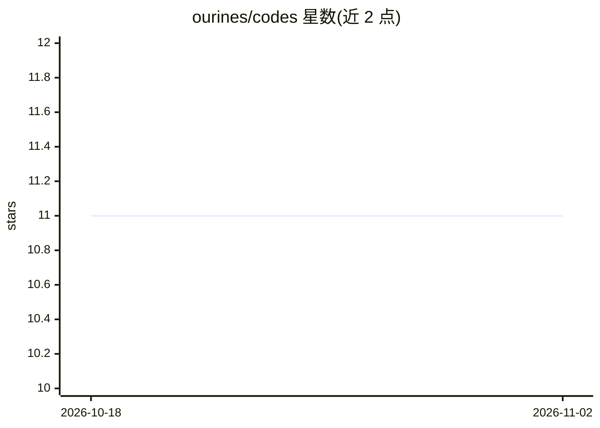

# ourines/codes

⭐ 11 · Go · MIT · 推送 2026-02-27 · [GitHub](https://github.com/ourines/codes) · 个人维护 · 中文 README

**Claude Code 多配置切换与多 agent 团队编排 CLI 工具**

用 Go 编写的 Claude Code 周边管理工具：支持多 API 配置（Anthropic 官方、代理、自定义端点）即时切换，管理项目别名与工作区，并通过共享文件任务队列编排自主 Claude agent 团队（agent 以守护进程轮询，spawn Claude CLI 子进程执行任务）。提供 43 个 MCP 工具、单端口 HTTP REST API 服务器（含 WebSocket 会话与飞书 webhook）、YAML 工作流模板与按项目/模型的成本统计。跨 Linux/macOS/Windows，安装后需 codes init 初始化。

## 筛选速览

| 维度 | 判定 | 备注 |
|---|---|---|
| AI 角色 | `ai-ecosystem` | LLM/agent 周边工具 |
| 许可风险 | `permissive` | MIT |
| 部署形态 | `None` |  |
| 模型依赖 | locked-api |  |
| 硬件要求 | — | 无带数字的原话,不猜 |
| 安装摩擦 | `low` | 无编译、无系统依赖或容器化 |
| 成熟度 | — | 结构信号不足 |

## 能力要点

- 多 API profile 管理与即时切换（官方/代理/自定义端点）
- 自主 agent 团队：守护进程 + 文件任务队列，无数据库与消息中间件
- 43 个 MCP 工具（stdio + SSE）与单端口 REST API 服务器
- YAML 工作流模板与按项目/模型的成本统计

## 适用场景

- 在多个 Claude API 端点与认证 token 之间快速切换
- 编排多个 Claude agent 并行处理带依赖的任务流水线
- 远程或移动端通过 REST API/WebSocket 管理 Claude Code 会话
- 统计各项目各模型的 API 用量成本

## 场景标签

`多智能体` · 领域:Agent 开发

## 证据(README 行号)

> L5: Environment configuration management, project management, and multi-agent collaboration tool for Claude Code. Switch

## 星数曲线

2026-10-18 11 → 2026-11-02 11（+0）

---
*卡片 v1 · prompt 1.4 · 生成 2026-11-01 · 置信度 high · 依据 README sha `2feba2633ce3` · [字段定义](../../DATASET.md)*
