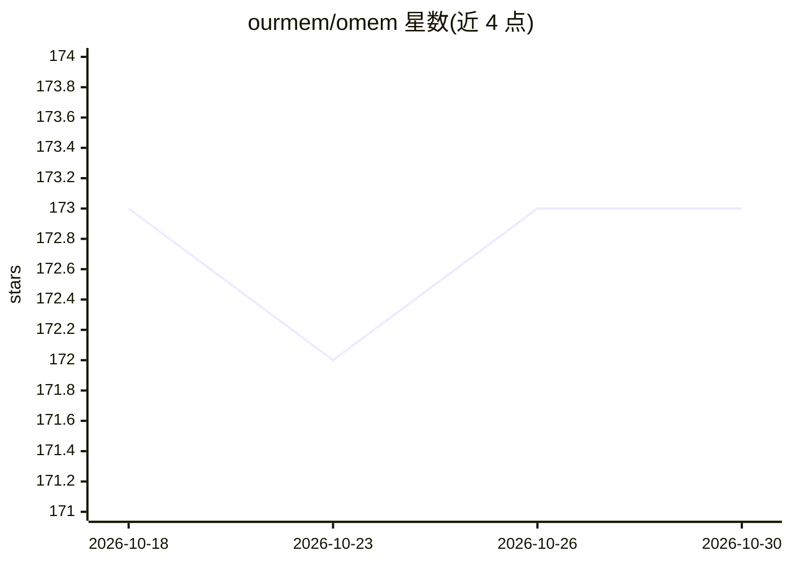

# ourmem/omem

⭐ 173 · Rust · NOASSERTION · 推送 2026-05-24 · [GitHub](https://github.com/ourmem/omem) · [官网](https://ourmem.ai) · 组织维护 · 中文 README

**给 AI agent 用的跨会话共享持久记忆服务，含自托管与托管版**

为 AI agent 提供跨会话、跨设备、跨 agent 与团队的持久记忆层：以三级 Space（Personal/Team/Organization）组织记忆并携带溯源信息共享，采用向量+BM25+RRF+重排的 11 阶段混合检索与 Weibull 衰减生命周期管理，写入侧有 7 种去重裁决与噪声过滤。提供 OpenCode、Claude Code、OpenClaw 插件与 MCP Server 接入，REST API 48+ 端点；支持 Docker 单行自托管（Rust 单二进制、musl 静态构建）或 ourmem.ai 托管。面向使用 AI 编码工具的用户与构建 AI 产品的开发者。

## 筛选速览

| 维度 | 判定 | 备注 |
|---|---|---|
| AI 角色 | `ai-ecosystem` | LLM/agent 周边工具 |
| 许可风险 | `none` | NOASSERTION |
| 部署形态 | `self-host` | docker 或自建部署 |
| 模型依赖 | — | README 未给出锁定关系 |
| 硬件要求 | — | 无带数字的原话,不猜 |
| 安装摩擦 | `low` | 无编译、无系统依赖或容器化 |
| 成熟度 | — | 结构信号不足 |

## 能力要点

- 三级 Space 共享架构（Personal/Team/Organization）含溯源跟踪与版本管理
- 11 阶段混合检索管道（向量 + BM25 + RRF + 重排 + MMR）
- 7 决策记忆去重（CREATE/MERGE/SUPERSEDE 等）与 Weibull 衰减生命周期
- 4 平台接入：OpenCode、Claude Code、OpenClaw、MCP Server

## 适用场景

- 让我的编码 agent 在不同会话间记住偏好与决策
- 团队内多个 agent 共享架构决策与技术标准
- 通过 API 给自研 AI 产品嵌入持久记忆

## 场景标签

`Agent 记忆` · 领域:Agent 开发

## 证据(README 行号)

> L25: ourmem gives AI agents shared persistent memory — across sessions, devices, agents, and teams. One API key reconnec
> L37: REST API with 48+ endpoints. Docker one-liner for self-deploy. Embed persistent memory into your own agents and wor
> L63: |**Platforms**|4 platforms|OpenCode, Claude Code, OpenClaw, MCP Server|

## 星数曲线

2026-10-18 173 → 2026-10-30 173（+0）

---
*卡片 v1 · prompt 1.4 · 生成 2026-10-22 · 置信度 high · 依据 README sha `cbdff8e09a45` · [字段定义](../../DATASET.md)*
