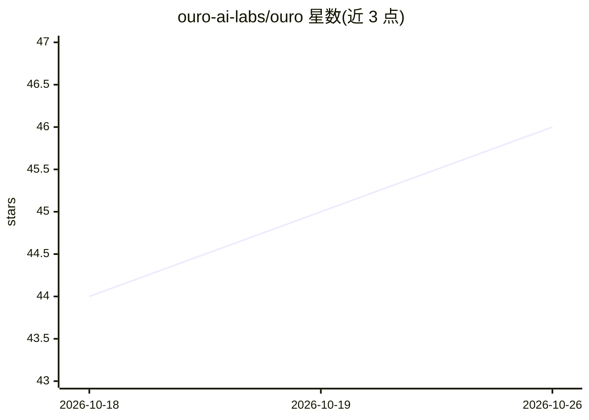

# ouro-ai-labs/ouro

⭐ 46 · Python · MIT · 推送 2026-07-28 · [GitHub](https://github.com/ouro-ai-labs/ouro) · 组织维护

**开源 AI agent：可作编码 CLI 或部署为 IM 机器人**

Ouro 是一个统一 agent 核心的开源 AI agent，提供两种部署模式：CLI 模式（交互式 REPL 与单次任务执行）与 Bot 模式（Lark、Slack、微信等平台的常驻 IM 助手）。核心机制包括：SQLite 持久化任务存储与多 agent 并行执行的 Agent Swarm、agent 自检答案并重入循环的 Ralph Loop 自验证、LLM 驱动的记忆压缩与会话恢复，以及通过 models.yaml 配置 API key、经 LiteLLM 接入多模型。需 Python 3.12+，推荐 uv 工具安装。

## 筛选速览

| 维度 | 判定 | 备注 |
|---|---|---|
| AI 角色 | `ai-native` | 本体是模型或模型工具 |
| 许可风险 | `permissive` | MIT |
| 部署形态 | `library` | 以包/库形式分发 |
| 模型依赖 | — | README 未给出锁定关系 |
| 硬件要求 | — | 无带数字的原话,不猜 |
| 安装摩擦 | `low` | 无编译、无系统依赖或容器化 |
| 成熟度 | — | 结构信号不足 |

## 能力要点

- Agent Swarm：SQLite 持久任务存储、依赖图与多 agent 并行执行
- Ralph Loop 自验证：agent 核对答案并在未完成时重入循环
- CLI 与 Bot 双模式共享同一 agent 核心，Bot 支持 Lark/Slack/微信
- 记忆系统：LLM 压缩、FTS5 对话召回、跨重启的 YAML 会话持久化

## 适用场景

- 在终端以 CLI 交互方式完成编码与任务执行
- 部署常驻 IM 机器人接入 Lark/Slack/微信处理消息
- 用 Harbor 在 agent 基准上评测模型表现

## 场景标签

`编码 Agent` `多智能体` `聊天机器人` · 领域:Agent 开发

## 证据(README 行号)

> L7: *An open-source AI agent — run it as a Coding agent CLI or deploy it as a bot just like JARVIS.*
> L19: |**What**|Interactive REPL + one-shot task execution|Persistent IM assistant (Lark, Slack)|
> L55: - **Bot** — Persistent IM assistant for Lark, Slack, WeChat with proactive cron scheduling

## 星数曲线

2026-10-18 44 → 2026-10-26 46（+2）

---
*卡片 v1 · prompt 1.4 · 生成 2026-10-25 · 置信度 high · 依据 README sha `1025671a3648` · [字段定义](../../DATASET.md)*
