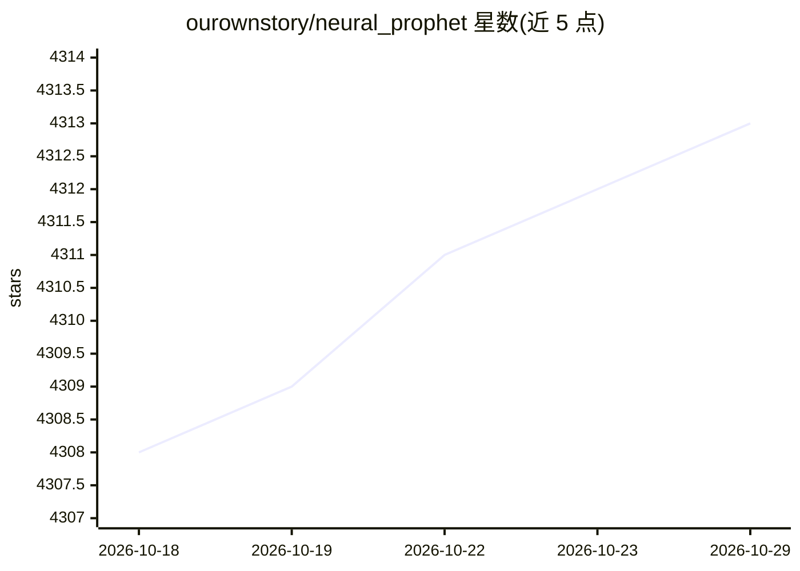

# ourownstory/neural_prophet

⭐ 4,313 · Python · MIT · 推送 2026-10-27 · [GitHub](https://github.com/ourownstory/neural_prophet) · [官网](https://neuralprophet.com) · 组织维护

**基于 PyTorch 的可解释时间序列预测框架**

基于 PyTorch 构建的时间序列预测框架，结合神经网络与传统时序算法，设计思路来自 Facebook Prophet 与 AR-Net，面向迭代式人机协同建模：快速建模、解释结果、调整再迭代。支持自回归、趋势、季节性、滞后/未来回归量、事件与全局建模等组件，提供分位数回归、交叉验证工具与绘图函数。以 pip 安装的 Python 包提供，README 声明项目仍处于 beta 阶段，Windows 用户需使用 WSL2。

## 筛选速览

| 维度 | 判定 | 备注 |
|---|---|---|
| AI 角色 | `ai-native` | 本体是模型或模型工具 |
| 许可风险 | `permissive` | MIT |
| 部署形态 | `desktop` | 安装包/桌面程序 |
| 模型依赖 | — | README 未给出锁定关系 |
| 硬件要求 | — | 无带数字的原话,不猜 |
| 安装摩擦 | `low` | 无编译、无系统依赖或容器化 |
| 成熟度 | `idea` | |

## 能力要点

- 模型组件：自回归、趋势、季节性、滞后/未来回归量、事件、全局建模
- 分位数回归（不确定性估计）与时间序列交叉验证工具
- 内置预测组件、模型系数等绘图函数
- 支持多条时间序列的共享参数全局建模

## 适用场景

- 高频（亚日级）且较长（至少两个完整周期）时间序列的预测
- 需要可解释预测结果的业务预测建模
- 在 Jupyter 中边训练边观察损失曲线的迭代式建模

## 场景标签

 · 领域:时间序列预测/机器学习

## 证据(README 行号)

> L16: NeuralProphet is an easy to learn framework for interpretable time series forecasting.
> L17: NeuralProphet is built on PyTorch and combines Neural Networks and traditional time-series algorithms, inspired by 
> L19: - It is designed for iterative human-in-the-loop model building. That means that you can build a first model quickl

## 星数曲线

2026-10-18 4,308 → 2026-10-29 4,313（+5）

---
*卡片 v1 · prompt 1.4 · 生成 2026-10-20 · 置信度 high · 依据 README sha `1046c2f0b146` · [字段定义](../../DATASET.md)*
