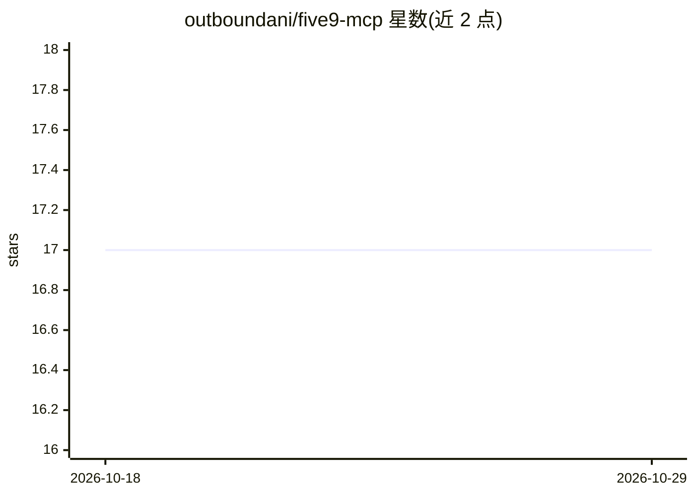

# outboundani/five9-mcp

⭐ 17 · JavaScript · MIT · 推送 2026-10-14 · [GitHub](https://github.com/outboundani/five9-mcp) · 个人维护

**连接 Five9 呼叫中心的零依赖 MCP 服务器（77 个工具）**

部署在 Cloudflare Workers 上的开源 MCP 服务器，把 Five9 云呼叫中心的 Configuration 与 Statistics SOAP Web Services 封装为 MCP 工具，覆盖活动管理、拨号列表、CRM 联系人、合规 DNC、用户技能与 IVR 构建等 77 个工具（69 个 SOAP + 8 个 OAuth REST）。支持一键部署到 Cloudflare，内置网页设置向导、交互式控制台与单操作者 OAuth 2.1 授权服务。可通过自定义连接器接入 Claude 与 ChatGPT，IVR 构建采用约束 JSON 流程规格加图校验生成脚本 XML，提示音语音生成基于 Workers AI。面向使用 Five9 并想让 AI 客户端操作呼叫中心的运营者与开发者。

## 筛选速览

| 维度 | 判定 | 备注 |
|---|---|---|
| AI 角色 | `ai-ecosystem` | LLM/agent 周边工具 |
| 许可风险 | `permissive` | MIT |
| 部署形态 | `library` | 以包/库形式分发 |
| 模型依赖 | locked-api |  |
| 硬件要求 | — | 无带数字的原话,不猜 |
| 安装摩擦 | `low` | 无编译、无系统依赖或容器化 |
| 成熟度 | — | 结构信号不足 |

## 能力要点

- 77 个工具覆盖活动/列表/联系人/DNC/用户/IVR 等 Five9 域操作
- 一键部署到 Cloudflare Workers，零 npm 依赖，内置网页设置向导与交互控制台
- 内置单操作者 OAuth 2.1 授权服务（PKCE、HMAC 无状态令牌）
- IVR 构建器用约束 JSON 流程规格 + 图校验生成脚本 XML，含 Workers AI TTS 语音生成

## 适用场景

- 让 Claude/ChatGPT 查询和管理我的 Five9 活动与拨号列表
- 通过对话让 AI 设计并部署完整 IVR 呼叫流程
- 在浏览器控制台直接调用工具调试 Five9 域配置

## 场景标签

 · 领域:CCaaS/呼叫中心集成

## 证据(README 行号)

> L5: An open-source MCP server that connects Claude, ChatGPT, or any MCP client to the **Five9** cloud contact center — r
> L27: Under the hood, this server speaks Five9's Configuration (admin) and Statistics (supervisor) **SOAP Web Services** 

## 星数曲线

2026-10-18 17 → 2026-10-29 17（+0）

---
*卡片 v1 · prompt 1.4 · 生成 2026-10-29 · 置信度 mid · 依据 README sha `9426609569be` · [字段定义](../../DATASET.md)*
