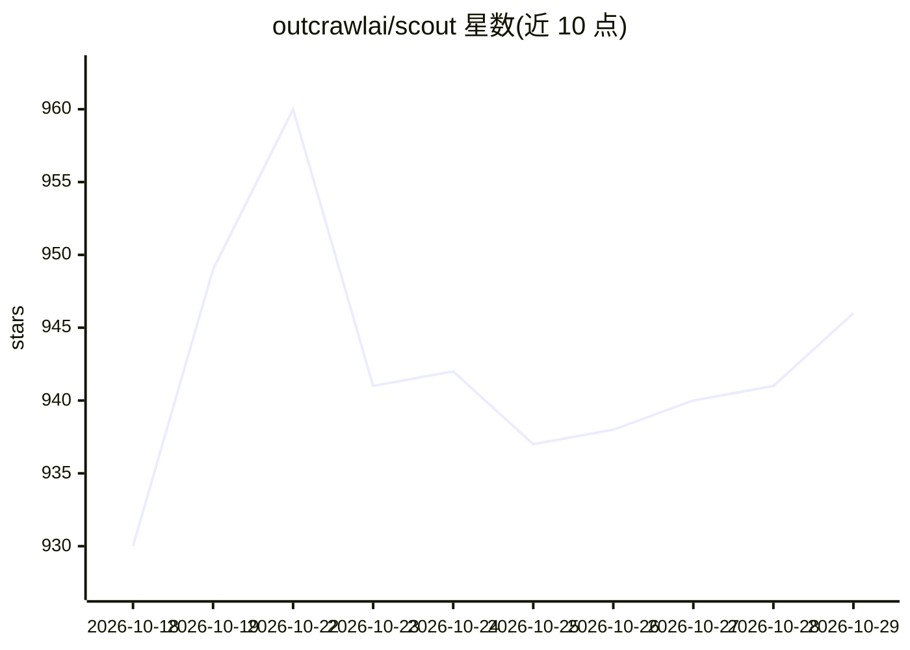

# outcrawlai/scout

⭐ 946 · TypeScript · Apache-2.0 · 推送 2026-10-21 · [GitHub](https://github.com/outcrawlai/scout) · [官网](https://outcrawl.ai) · 组织维护

**开源浏览器代理：用自然语言任务驱动真实浏览器完成操作**

TypeScript 实现的开源 agent，通过 CDP 驱动真实 Chrome/Chromium 浏览器：用户以自然语言描述任务，Scout 读页面、点击、输入、滚动直至完成并返回答案。自身不内置模型，接入任何符合 chat completions API 的模型服务，并按 hands/brain/eyes/extract 四种角色分配不同模型。可在 Outcrawl 云端浏览器运行（含验证码处理与运行录制），也可用本地 Playwright Chromium；本地运行需 Node 22+。运行结果带状态、步骤记录、费用与步数/时长/预算限制。

## 筛选速览

| 维度 | 判定 | 备注 |
|---|---|---|
| AI 角色 | `ai-native` | 本体是模型或模型工具 |
| 许可风险 | `permissive` | Apache-2.0 |
| 部署形态 | `library` | 以包/库形式分发 |
| 模型依赖 | — | README 未给出锁定关系 |
| 硬件要求 | — | 无带数字的原话,不猜 |
| 安装摩擦 | `low` | 无编译、无系统依赖或容器化 |
| 成熟度 | — | 结构信号不足 |

## 能力要点

- 自然语言任务驱动真实浏览器完成点击、输入、滚动等操作
- hands/brain/eyes/extract 四角色分工，兼容任意 chat completions API 模型服务
- 支持 Outcrawl 云端浏览器（住宅 IP、验证码处理、运行录制）或本地 Chromium
- 结果含结构化 schema 输出、步骤记录与步数/时长/预算上限

## 适用场景

- 让 agent 替我浏览网页做调研并汇总答案
- 自动填表、登录、比价等浏览器操作任务
- 按固定 JSON 结构从网页提取数据

## 场景标签

`浏览器自动化` · 领域:效率与自动化

## 证据(README 行号)

> L23: Scout is an open-source agent that uses a real browser to finish a task for you. Describe what you need in plain wo
> L78: Scout has no built-in model and no default. You choose a model for each job, on any service that speaks the chat co

## 星数曲线

2026-10-18 930 → 2026-10-29 946（+16）

---
*卡片 v1 · prompt 1.4 · 生成 2026-10-21 · 置信度 high · 依据 README sha `c1d213c0619b` · [字段定义](../../DATASET.md)*
