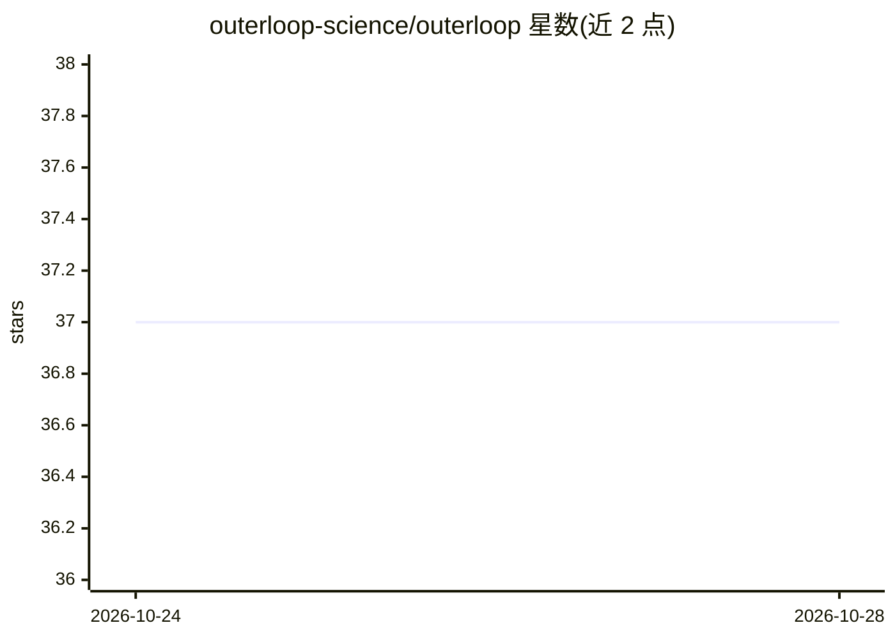

# outerloop-science/outerloop

⭐ 37 · Python · Apache-2.0 · 推送 2026-10-27 · [GitHub](https://github.com/outerloop-science/outerloop) · [官网](https://outerloop.science) · 组织维护

**在自有代码库上自动跑实验、仅在基准真实提升时开 PR 的自动研究 agent 系统**

Outerloop 在用户自己的研究代码库上运行 AI agent 循环：agent 提出假设并写代码改动，在用户的 Slurm 集群或 GPU 机器上跑实验，内核以相同种子对基准树重新测量，评审模型核查改动与声明后开 pull request；每次尝试（含失败）都会生成报告。由 NYU Agentic Learning AI Lab 开发并每日使用。通过合约限定改动路径、内核强制执行 GPU 时长等预算，支持 Claude Code、Codex、hermes-agent 后端。以 pip 包安装，需 Python 3.12+、uv、Git 2.38+ 与模型 API key；macOS 会话运行于 Seatbelt 配置下，Linux 无容器时会话可读取账户可读的任意文件。

## 筛选速览

| 维度 | 判定 | 备注 |
|---|---|---|
| AI 角色 | `ai-ecosystem` | LLM/agent 周边工具 |
| 许可风险 | `permissive` | Apache-2.0 |
| 部署形态 | `library` | 以包/库形式分发 |
| 模型依赖 | — | README 未给出锁定关系 |
| 硬件要求 | — | 无带数字的原话,不猜 |
| 安装摩擦 | `low` | 无编译、无系统依赖或容器化 |
| 成熟度 | — | 结构信号不足 |

## 能力要点

- 五步循环：提出假设→集群实验→同种子复测→评审→PR 与报告（含负结果）
- 内核强制执行改动路径合约与 GPU 时长/每周运行次数预算
- 支持 Claude Code、Codex、hermes-agent 及自托管端点
- 不可信输入以 fenced data 形式呈现，容器内会话无 GitHub 凭据

## 适用场景

- 让 AI agent 在我的研究代码库上持续尝试改进基准指标
- 自动复测并过滤噪声提升，只让真实改进进入 pull request
- 在自有集群与 API key 上运行自动研究流程，数据不外传

## 场景标签

`科研工具` · 领域:学习与行业

## 证据(README 行号)

> L12: Outerloop runs AI agents on your own research code. An agent proposes a
> L17:  One attempt: an agent proposes a change, runs the experiment on your GPUs, the kernel re-measures it against the b
> L78: 1. **Propose.** An agent picks a hypothesis and writes the code change.

## 星数曲线

2026-10-24 37 → 2026-10-28 37（+0）

---
*卡片 v1 · prompt 1.4 · 生成 2026-10-25 · 置信度 high · 依据 README sha `f64de02bad70` · [字段定义](../../DATASET.md)*
