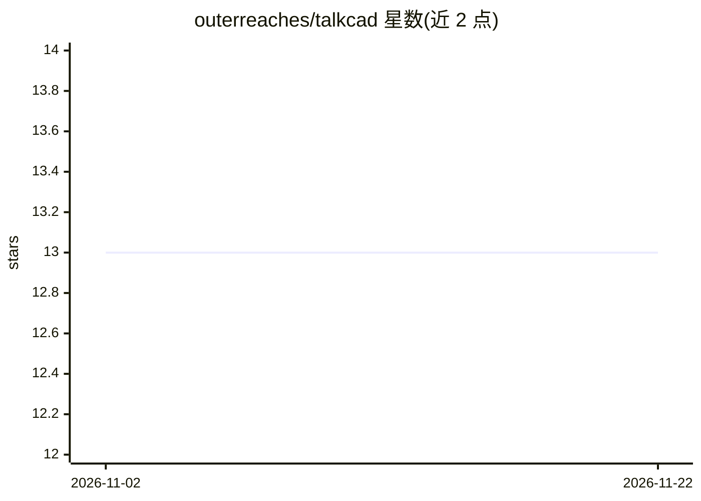

# outerreaches/talkcad

⭐ 13 · TypeScript · MIT · 推送 2026-11-01 · [GitHub](https://github.com/outerreaches/talkcad) · [官网](https://talkcad.app) · 个人维护

**桌面 CAD 工具：LLM agent 依自然语言生成参数化 OpenSCAD 并导出 STL**

基于 Electron 的桌面 CAD 工具，内置多 agent 架构（Orchestrator/Builder/Researcher）：从自然语言描述与硬尺寸生成 OpenSCAD 代码，调用外部 OpenSCAD 渲染，按规格做代码与视觉校验，失败进入有界自修复循环，最终导出可打印 STL。内置设计规则、标准尺寸等技能库，支持网页检索真实尺寸与参考图片。LLM 通过 OpenRouter/OpenAI/Gemini/Groq 等云端或 Ollama/LM Studio/llama.cpp 等本地后端提供。

## 筛选速览

| 维度 | 判定 | 备注 |
|---|---|---|
| AI 角色 | `ai-native` | 本体是模型或模型工具 |
| 许可风险 | `permissive` | MIT |
| 部署形态 | `desktop` | 安装包/桌面程序 |
| 模型依赖 | local-ok | 支持本地模型 |
| 硬件要求 | — | 无带数字的原话,不猜 |
| 安装摩擦 | `low` | 无编译、无系统依赖或容器化 |
| 成熟度 | — | 结构信号不足 |

## 能力要点

- 自然语言生成参数化 OpenSCAD，代码可读可编辑可保留
- 规格追踪与自动校验：代码校验、渲染统计、视觉模型核验，失败回送修复
- 多 agent 协作（Orchestrator/Builder/Researcher）与内置知识库
- 支持本地与云端 LLM：OpenRouter、OpenAI、Gemini、Groq、Ollama、LM Studio、llama.cpp

## 适用场景

- 用自然语言快速生成参数化 3D 打印模型并导出 STL
- 为有硬性尺寸要求的零件自动校验几何是否符合规格
- 本地模型环境下离线生成 CAD 代码

## 场景标签

`代码生成` · 领域:编码与开发

## 证据(README 行号)

> L5: **Describe a part in plain language. Get parametric OpenSCAD, a live 3D preview, and a printable STL.**
> L9: TalkCAD is a desktop CAD tool built around an LLM agent that writes OpenSCAD
> L23: - **Local or cloud models** — OpenRouter, OpenAI, Gemini, Groq, Ollama, LM Studio, llama.cpp, or any OpenAI-compati

## 星数曲线

2026-11-02 13 → 2026-11-22 13（+0）

---
*卡片 v1 · prompt 1.4 · 生成 2026-11-18 · 置信度 mid · 依据 README sha `6b58b73063bc` · [字段定义](../../DATASET.md)*
