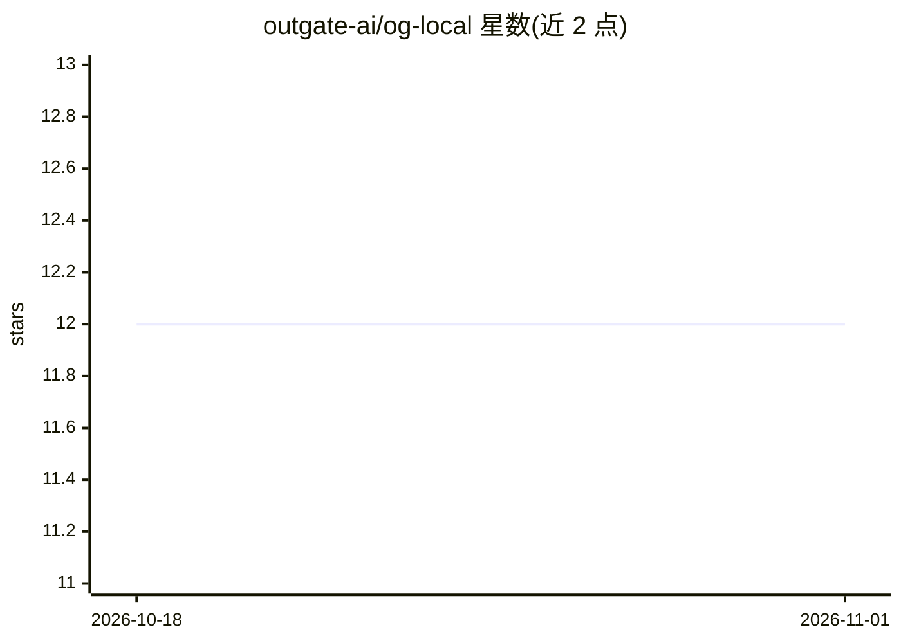

# outgate-ai/og-local

⭐ 12 · Go · NOASSERTION · 推送 2026-10-28 · [GitHub](https://github.com/outgate-ai/og-local) · [官网](https://outgate.ai) · 组织维护

**本地隐私代理：在编程 agent 请求出站前检出并脱敏 PII/密钥**

单二进制本地代理，拦截 Claude Code、Codex 等编程 agent 的 LLM API 请求，用 openai/privacy-filter ONNX 模型在进程内检测提示中的 PII 与密钥，替换为确定性占位符后转发上游，并在响应（含 SSE 流式）中原位还原。代理通过随机回环端口拉起子进程 agent，支持 OpenAI Chat Completions/Responses、ChatGPT 订阅 Codex、Anthropic Messages。macOS Intel 目标仅支持透传不可脱敏。许可证为 BSL 1.1，2030-06-08 自动转为 Apache 2.0。

## 筛选速览

| 维度 | 判定 | 备注 |
|---|---|---|
| AI 角色 | `ai-ecosystem` | LLM/agent 周边工具 |
| 许可风险 | `none` | NOASSERTION |
| 部署形态 | `desktop` | 安装包/桌面程序 |
| 模型依赖 | locked-api |  |
| 硬件要求 | — | 无带数字的原话,不猜 |
| 安装摩擦 | `low` | 无编译、无系统依赖或容器化 |
| 成熟度 | — | 结构信号不足 |

## 能力要点

- 进程内 ONNX 检测，除上游 provider 外无网络调用
- 占位符在会话期内确定，保持 prompt caching 可用
- 支持流式 SSE 响应中的跨事件占位符还原
- ogl model pull 一次性下载约 840MB 模型与 ONNX Runtime

## 适用场景

- 编程 agent 读取含密钥或客户数据文件时防止外泄
- 在合规要求下让 agent 继续使用云端 LLM
- 在 VS Code 中以 wrapper 方式接入 Claude Code 扩展

## 场景标签

 · 领域:开发者工具/LLM 隐私代理

## 证据(README 行号)

> L14: **og-local** is a single binary that runs on your machine, intercepts the API calls your agent makes, detects PII a
> L16: Detection runs in-process via the `openai/privacy-filter` ONNX model. There's no cloud round-trip and no network ca
> L104: For each outbound request, `ogl` extracts the user-supplied content fields (`messages[].content`, `system`, tool-c

## 星数曲线

2026-10-18 12 → 2026-11-01 12（+0）

---
*卡片 v1 · prompt 1.4 · 生成 2026-11-01 · 置信度 high · 依据 README sha `bafb65a41f24` · [字段定义](../../DATASET.md)*
