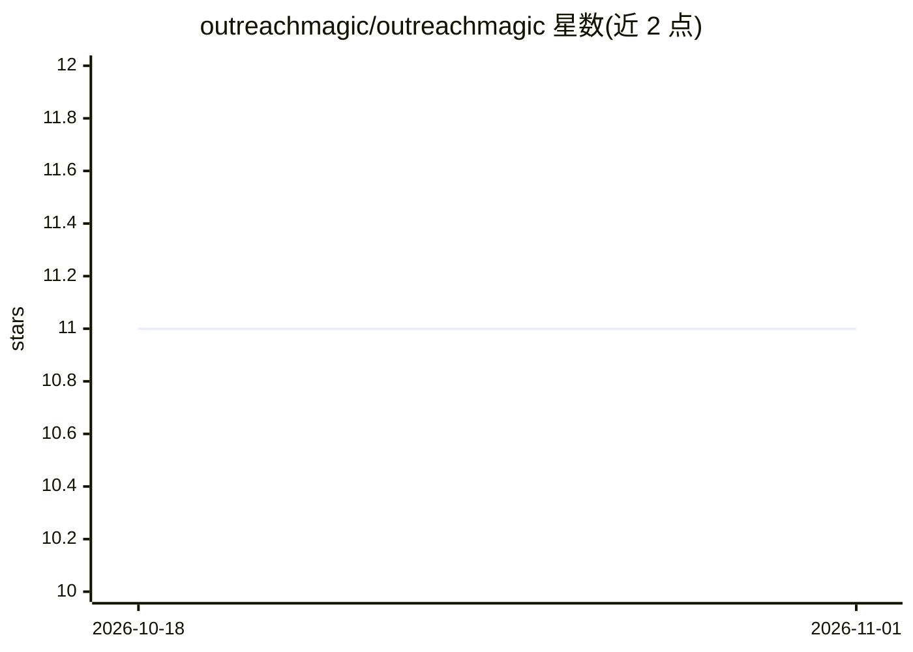

# outreachmagic/outreachmagic

⭐ 11 · Python · MIT · 推送 2026-10-22 · [GitHub](https://github.com/outreachmagic/outreachmagic) · [官网](https://outreachmagic.io) · 组织维护

**外联销售工具的 GTM 数据同步技能：让 AI agent 直接查询本地 SQLite 管道数据**

面向 Claude Code、Cursor、Hermes 等 agent 平台的 GTM 技能：将 Smartlead、Instantly、HeyReach、PlusVibe、EmailBison、Prosp、MasterInbox 和 Calendly 的事件（回复、退信、阶段变更、预约）经 outreachmagic.io 中继同步到本地 SQLite 数据库，供 agent 直接查询。另提供基于 Serper 的人物研究、邮箱瀑布式查找与验证（trykitt、Icypeas、MillionVerifier、Scrubby），以及推送 GoHighLevel 和 HubSpot 的 CRM 同步。通过 npx skills 安装，含 48+ 脚本、CI、测试与跨平台安装器。

## 筛选速览

| 维度 | 判定 | 备注 |
|---|---|---|
| AI 角色 | `ai-ecosystem` | LLM/agent 周边工具 |
| 许可风险 | `permissive` | MIT |
| 部署形态 | `library` | 以包/库形式分发 |
| 模型依赖 | — | README 未给出锁定关系 |
| 硬件要求 | — | 无带数字的原话,不猜 |
| 安装摩擦 | `low` | 无编译、无系统依赖或容器化 |
| 成熟度 | — | 结构信号不足 |

## 能力要点

- 将 8 个外联/日历平台事件同步至本地 SQLite 供 agent 查询
- 人物研究（LinkedIn、职位、公司域名，经 Serper）与邮箱瀑布查找/验证
- 推送联系人与交易到 GoHighLevel、HubSpot（Salesforce 计划中）
- 跨平台安装器支持 Hermes、Cursor、Claude Code

## 适用场景

- 让销售外联 agent 实时知道谁回复了、谁预约了，不再靠 CSV 拼接
- 按姓名和公司查找并验证潜在客户邮箱
- 将管道数据同步到 CRM 系统

## 场景标签

`网页抓取` · 领域:效率与自动化

## 证据(README 行号)

> L5: Your agent goes blind after send. Sync Smartlead, Instantly, HeyReach, PlusVibe, EmailBison, Prosp, MasterInbox, and
> L35: npx skills add outreachmagic/outreachmagic

## 星数曲线

2026-10-18 11 → 2026-11-01 11（+0）

---
*卡片 v1 · prompt 1.4 · 生成 2026-11-01 · 置信度 mid · 依据 README sha `edcdd4b7e03a` · [字段定义](../../DATASET.md)*
