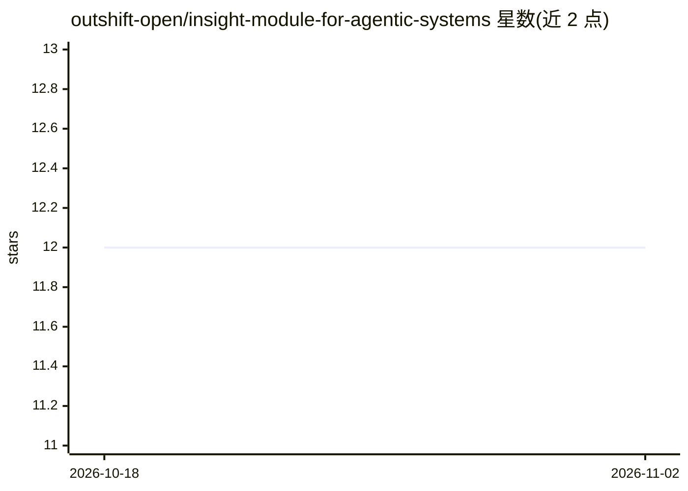

# outshift-open/insight-module-for-agentic-systems

⭐ 12 · TypeScript · Apache-2.0 · 推送 2026-10-30 · [GitHub](https://github.com/outshift-open/insight-module-for-agentic-systems) · 组织维护

**为 OpenClaw 提供 OpenTelemetry 追踪与指标的观测插件**

面向 OpenClaw 多 agent 工作流的可观测性插件：基于 OpenTelemetry 采集请求、agent、工具、出站消息的关联追踪，并富化 LLM 用量、模型、token 与成本信息，同时采集网关诊断信号（队列、webhook、会话、工具循环）。可选开启 Anthropic、OpenAI、Bedrock、Vertex AI 的 provider SDK 自动插桩。通过 docker-compose 启动本地观测栈、npm 安装依赖并加载到 OpenClaw 配置，仓库另含 SRE 分诊示例多 agent 应用与文档。

## 筛选速览

| 维度 | 判定 | 备注 |
|---|---|---|
| AI 角色 | `ai-ecosystem` | LLM/agent 周边工具 |
| 许可风险 | `permissive` | Apache-2.0 |
| 部署形态 | `self-host` | docker 或自建部署 |
| 模型依赖 | — | README 未给出锁定关系 |
| 硬件要求 | — | 无带数字的原话,不猜 |
| 安装摩擦 | `low` | 无编译、无系统依赖或容器化 |
| 成熟度 | — | 结构信号不足 |

## 能力要点

- 请求/agent/工具/出站消息的端到端关联追踪
- LLM 用量、模型、token 与成本富化
- 网关诊断信号（队列、webhook、会话、工具循环）
- Anthropic/OpenAI/Bedrock/Vertex AI SDK 可选自动插桩

## 适用场景

- 监控多 agent 系统的端到端请求链路
- 统计 LLM 调用的 token 与成本
- 排查 agent 网关的队列与工具循环问题

## 场景标签

`LLM 可观测性` · 领域:评测与运维

## 证据(README 行号)

> L3: This project adds OpenTelemetry-based tracing and metrics to
> L6: The main deliverable in this repository is the Insight Module plugin for OpenClaw, which captures:

## 星数曲线

2026-10-18 12 → 2026-11-02 12（+0）

---
*卡片 v1 · prompt 1.4 · 生成 2026-11-01 · 置信度 high · 依据 README sha `a5975130ec73` · [字段定义](../../DATASET.md)*
