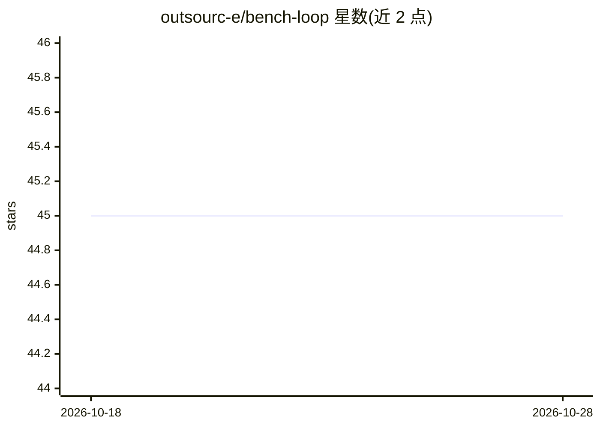

# outsourc-e/bench-loop

⭐ 45 · Python · MIT · 推送 2026-08-16 · [GitHub](https://github.com/outsourc-e/bench-loop) · [官网](https://bench-loop.com) · 个人维护

**本地优先的 LLM 基准测试 CLI：质量/速度/可靠性打分**

面向在自有硬件或云端端点上评测 LLM 的开发者：以 CLI 加本地 Web 面板形式运行，覆盖八个可重复套件（速度、工具调用、编码、长上下文、多轮 agent 循环等），评分公式为质量 0.70+速度 0.25+可靠性 0.05。支持 Ollama 及任意 OpenAI 兼容端点（LM Studio/MLX/vLLM/OpenRouter 等），区分本地与云端速度评分曲线；每次运行持久化到磁盘并附 SHA-256 提示清单以保证可复现。本地运行无需账号，发布到排行榜需配对账号。项目自述为 v0.3 beta。

## 筛选速览

| 维度 | 判定 | 备注 |
|---|---|---|
| AI 角色 | `ai-ecosystem` | LLM/agent 周边工具 |
| 许可风险 | `permissive` | MIT |
| 部署形态 | `library` | 以包/库形式分发 |
| 模型依赖 | local-ok | 支持本地模型 |
| 硬件要求 | — | 无带数字的原话,不猜 |
| 安装摩擦 | `low` | 无编译、无系统依赖或容器化 |
| 成熟度 | `idea` | |

## 能力要点

- 八个套件包括真实多轮 agent 循环（本地执行工具并回喂结果）
- 四种提示 harness（raw/hermes/qwen/pi）与冒烟/核心/完整三档 profile
- 运行持久化并附 SHA-256 提示与生成设置清单，保证可复现
- 打包内含 FastAPI+React 本地面板（含 agent 轨迹查看器）

## 适用场景

- 挑选本地模型+运行时+硬件组合前先跑基准对比
- 验证他人声称的模型分数能否在自己机器上复现
- 可视化对比多次基准运行并选择性发布到排行榜

## 场景标签

`模型评测` · 领域:评测与运维

## 证据(README 行号)

> L11: BenchLoop is a local-first CLI + web app for benchmarking LLMs running on your own hardware or cloud providers. It 
> L196: |`agent`|**Multi-turn agentic tool use.** BenchLoop drives a real loop: model emits a tool call, BenchLoop execute

## 星数曲线

2026-10-18 45 → 2026-10-28 45（+0）

---
*卡片 v1 · prompt 1.4 · 生成 2026-10-25 · 置信度 high · 依据 README sha `ecf824be4b3e` · [字段定义](../../DATASET.md)*
