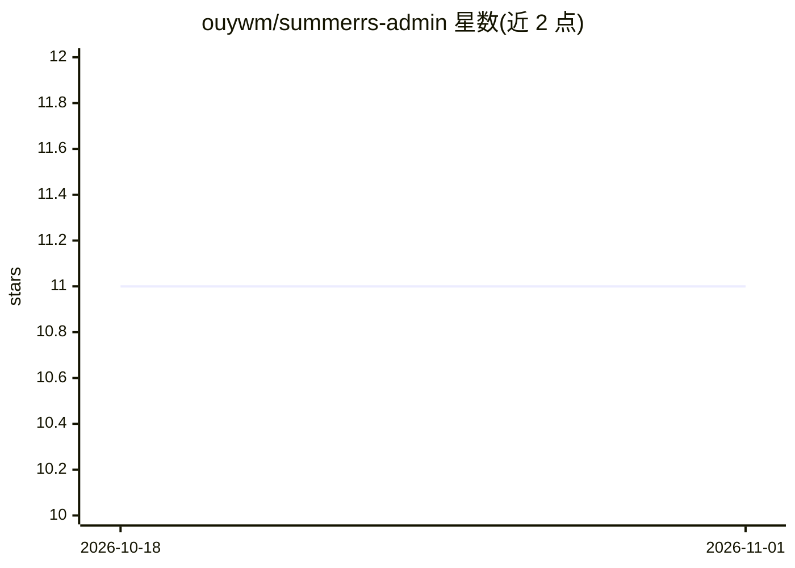

# ouywm/summerrs-admin

⭐ 11 · Rust · MIT · 推送 2026-08-10 · [GitHub](https://github.com/ouywm/summerrs-admin) · 个人维护 · 中文 README

**Rust 编写的生产级后台管理系统（含 MCP 能力）**

完全用 Rust 实现的后台 admin 系统，组合 Summer 生态的 Web、SeaORM、Redis、定时任务、对象存储与 MCP 等能力，提供权限（RBAC）、菜单、用户、文件、日志、通知与运维工具等常见后台功能；核心管理模块覆盖用户、角色、菜单、按钮、资源、字典、配置、公告、日志、在线用户与监控。前端基于 Ant Design Pro 的 art-design-pro 仓库实现，另提供文档站点。README 未展示安装运行命令。

## 筛选速览

| 维度 | 判定 | 备注 |
|---|---|---|
| AI 角色 | `ai-enhanced` | 去掉 AI 部分产品仍成立 |
| 许可风险 | `permissive` | MIT |
| 部署形态 | `None` |  |
| 模型依赖 | — | README 未给出锁定关系 |
| 硬件要求 | — | 无带数字的原话,不猜 |
| 安装摩擦 | `low` | 无编译、无系统依赖或容器化 |
| 成熟度 | — | 结构信号不足 |

## 能力要点

- 完全用 Rust 编写的后台 admin 系统
- 组合 Summer 生态：Web/SeaORM/Redis/定时任务/对象存储/MCP
- 内置 RBAC 与用户、菜单、日志、监控等后台管理模块
- 前端基于 Ant Design Pro（art-design-pro），配套文档站点

## 适用场景

- 搭建需要权限与用户管理的后台管理系统
- Rust 技术栈团队复用成品后台基建
- 需要 MCP 等能力接入的后台场景

## 场景标签

 · 领域:后端/管理系统

## 证据(README 行号)

> L13: `summerrs-admin` is a production-grade admin system **written entirely in Rust**. It combines Web, SeaORM, Redis, c
> L17: - **System Management and RBAC**: built-in backend admin modules for users, roles, menus, buttons, resources, dicti

## 星数曲线

2026-10-18 11 → 2026-11-01 11（+0）

---
*卡片 v1 · prompt 1.4 · 生成 2026-11-01 · 置信度 mid · 依据 README sha `0903c7b3034d` · [字段定义](../../DATASET.md)*
