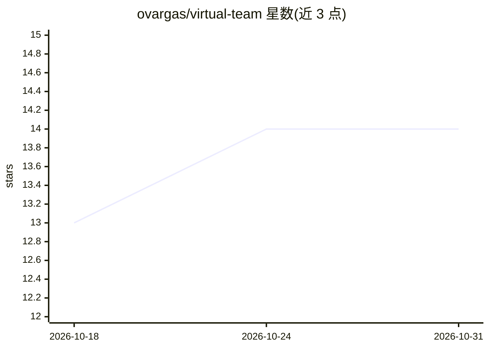

# ovargas/virtual-team

⭐ 14 · TypeScript · MIT · 推送 2026-10-28 · [GitHub](https://github.com/ovargas/virtual-team) · 个人维护

**把 Claude Code/Codex 变成虚拟开发团队的插件**

一个开发代理插件，为 Claude Code 与 Codex 提供从想法到交付代码的流程管线：通过斜杠命令、技能与代理执行 TDD、契约先行开发与质量门禁。核心流程为 feature→contracts→plan→implement→review+validate→pr，支持中断续跑、bug 修复管线、代码审查、规范核对、文档生成与多仓 hub 协调。初始化时生成分技术栈约定的 stack.md，技能按上下文自动加载编码标准。安装通过 Claude Code/Codex 的 plugin marketplace 命令完成。

## 筛选速览

| 维度 | 判定 | 备注 |
|---|---|---|
| AI 角色 | `ai-ecosystem` | LLM/agent 周边工具 |
| 许可风险 | `permissive` | MIT |
| 部署形态 | `None` |  |
| 模型依赖 | — | README 未给出锁定关系 |
| 硬件要求 | — | 无带数字的原话,不猜 |
| 安装摩擦 | `low` | 无编译、无系统依赖或容器化 |
| 成熟度 | — | 结构信号不足 |

## 能力要点

- spec→contracts→plan→implement→review→pr 全流程管线，支持中断后续跑
- 原生支持 Claude Code 与 Codex 两种宿主
- 技能按上下文自动加载领域编码标准（API/UI/数据层等）
- 支持存量代码库渐进接入，onboarding 不改动现有代码

## 适用场景

- 让 AI 编码代理按固定流程从规格到 PR 完整交付功能
- 对存量老项目做渐进式规范化与技术债审计
- 用 /status 与 /handoff 管理跨会话的开发状态

## 场景标签

`编码 Agent` · 领域:编码与开发

## 证据(README 行号)

> L3: A development-agent plugin that turns Claude Code or Codex into a virtual development team. It provides a deliberate
> L9: |Claude Code|Slash commands, skills, agents, and hooks|Native|

## 星数曲线

2026-10-18 13 → 2026-10-31 14（+1）

---
*卡片 v1 · prompt 1.4 · 生成 2026-10-31 · 置信度 high · 依据 README sha `024e51b04cd8` · [字段定义](../../DATASET.md)*
