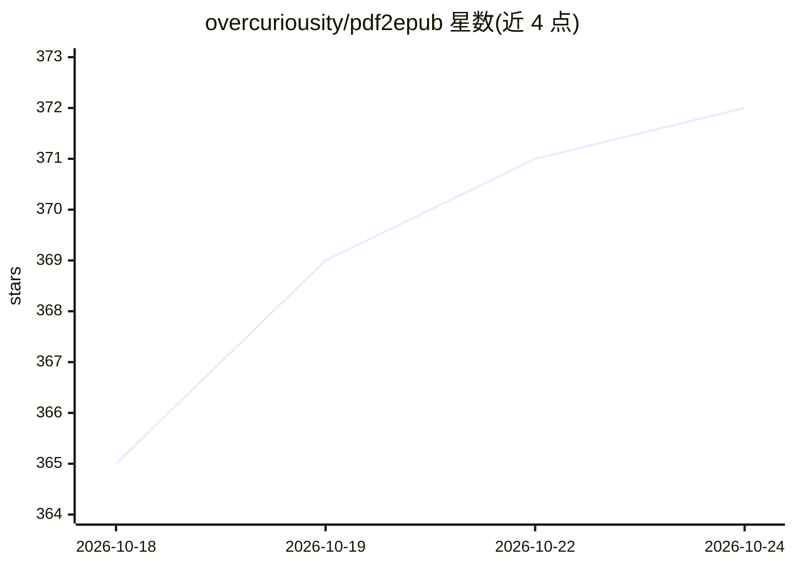

# overcuriousity/pdf2epub

⭐ 372 · Python · MIT · 推送 2026-10-09 · [GitHub](https://github.com/overcuriousity/pdf2epub) · 个人维护

**AI 版面识别的 PDF→Markdown/EPUB 转换工具**

命令行工具，读取 PDF 生成结构化 Markdown 与 EPUB：基于 marker-pdf 与 Transformers 做智能版面检测、文本提取/OCR、表格识别、图片提取与多语言支持。依赖 Python 3.10–3.14 与 PyTorch，支持 NVIDIA CUDA、AMD ROCm 与 Apple Silicon MPS 的 GPU 加速；EPUB 生成时交互式询问元数据，--skip-epub 可仅输出 Markdown。提供 Docker CPU 镜像（含 ghcr.io 发布）。已知限制：多栏布局、复杂数学公式、字体检测可能需手工调整。

## 筛选速览

| 维度 | 判定 | 备注 |
|---|---|---|
| AI 角色 | `ai-native` | 本体是模型或模型工具 |
| 许可风险 | `permissive` | MIT |
| 部署形态 | `self-host` | docker 或自建部署 |
| 模型依赖 | — | README 未给出锁定关系 |
| 硬件要求 | — | 无带数字的原话,不猜 |
| 安装摩擦 | `low` | 无编译、无系统依赖或容器化 |
| 成熟度 | — | 结构信号不足 |

## 能力要点

- 基于 marker-pdf/Transformers 的版面检测、OCR 与表格识别
- 生成 Markdown 与可定制样式的 EPUB
- 支持 CUDA/ROCm/Apple Silicon GPU 加速
- 可处理单文件或目录下全部 PDF，支持页码范围选择

## 适用场景

- 把书籍或论文 PDF 转成 Markdown/EPUB 阅读格式
- 批量转换目录内的 PDF 文档
- 在无 GPU 环境用 Docker 镜像运行转换

## 场景标签

`OCR` `文档解析` · 领域:知识与检索

## 证据(README 行号)

> L3: Convert PDF files to nicely structured Markdown and EPUB format with intelligent layout detection.
> L8: - 🔍 Advanced text extraction and OCR capabilities

## 星数曲线

2026-10-18 365 → 2026-10-24 372（+7）

---
*卡片 v1 · prompt 1.4 · 生成 2026-10-21 · 置信度 high · 依据 README sha `3377dc554aa9` · [字段定义](../../DATASET.md)*
