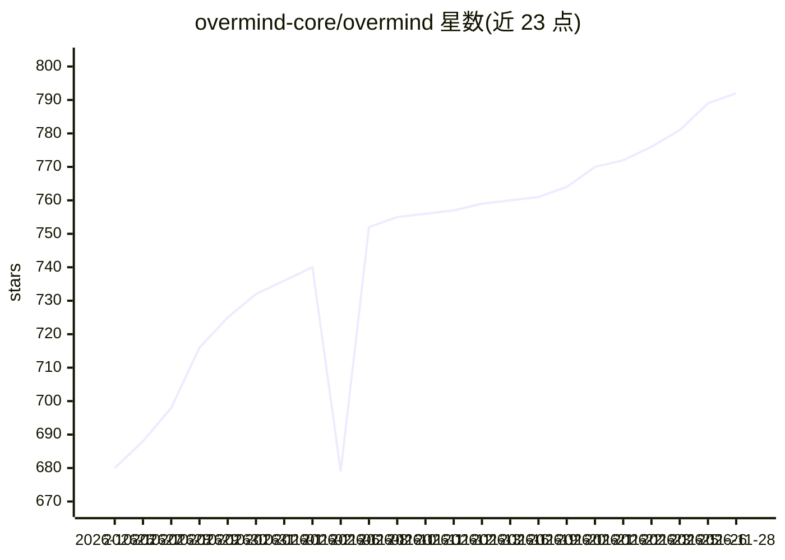

# overmind-core/overmind

⭐ 792 · Python · AGPL-3.0 · 推送 2026-11-27 · [GitHub](https://github.com/overmind-core/overmind) · [官网](https://overmindlab.ai) · 组织维护

**持续微调与改进 AI agent 的训练平台，含 SDK 与自托管栈**

面向 agent 开发者的训练平台：扫描 agent 代码库生成能力图谱，将生产 trace 或数据集转化为版本化评测与训练数据，按自定义 eval 指标进行 LoRA 微调、基准对比，并通过统一的 OpenAI 兼容 API 提供推理。支持 Console、CLI、REST API 与 MCP server 四种入口；SDK/CLI（MIT）可通过 pip 安装，平台（AGPL-3.0）可自托管，训练与部署依赖 Modal worker。权重可下载、重训与回滚。

## 筛选速览

| 维度 | 判定 | 备注 |
|---|---|---|
| AI 角色 | `ai-ecosystem` | LLM/agent 周边工具 |
| 许可风险 | `dual` | AGPL-3.0 |
| 部署形态 | `self-host` | docker 或自建部署 |
| 模型依赖 | locked-api |  |
| 硬件要求 | — | 无带数字的原话,不猜 |
| 安装摩擦 | `low` | 无编译、无系统依赖或容器化 |
| 成熟度 | — | 结构信号不足 |

## 能力要点

- 生产 trace → 数据集 → 微调 → 基准 → 统一推理 API 的闭环流程
- MCP server 提供覆盖项目/观测/数据集/评测/训练的工具集与工作流 prompts
- OpenTelemetry trace 接入，支持 Langfuse/LangSmith/Braintrust/Galileo 连接器同步
- SDK/CLI 为 MIT、平台为 AGPL-3.0 且可自托管

## 适用场景

- 把生产 trace 沉淀为数据集并对自有 agent 做持续微调
- 按能力维度定义评测指标并在线上与批量两种模式下度量
- 将训练模型与前沿模型放在同一 API 下服务并对比打分
- 在网络内自托管以保留 trace 与训练数据

## 场景标签

`微调` `模型评测` `LLM 可观测性` · 领域:评测与运维

## 证据(README 行号)

> L14: **Overmind continuously trains & improves your agents, with data from your production traces**
> L18: Point it at your agent's codebase and it turns production traces (or any dataset) into a fine-tuned model, benchmar
> L22: Available from the Console, the `overmind` CLI, the REST API, and an MCP server for Cursor, Claude Code, OpenCode a

## 星数曲线

2026-10-26 680 → 2026-11-28 792（+112）

---
*卡片 v1 · prompt 1.4 · 生成 2026-11-27 · 置信度 high · 依据 README sha `b304f4c442f6` · [字段定义](../../DATASET.md)*
