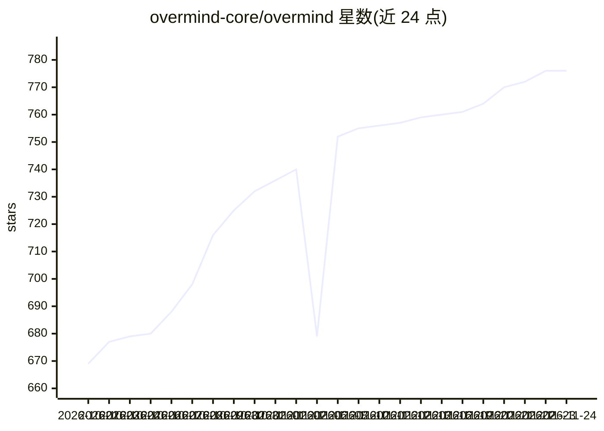

# overmind-core/overmind

⭐ 781 · Python · AGPL-3.0 · 推送 2026-11-23 · [GitHub](https://github.com/overmind-core/overmind) · [官网](https://overmindlab.ai) · 组织维护

**持续训练改进 AI agent 的平台：从生产 trace 产出微调模型**

面向拥有自研 agent 的团队：扫描 agent 仓库生成能力图谱，将生产 trace（OpenTelemetry）评分后转为版本化数据集，按自定义 eval 指标基准化，产出可下载的 LoRA 微调模型，并通过统一的 OpenAI 兼容 API 提供推理。分发形式为 MIT 许可的 SDK/CLI（pip install overmind），背后平台 AGPL-3.0，可托管使用或 docker compose 自托管。需要 OpenRouter、Modal、AWS、Hugging Face 等密钥才能完成评估与训练闭环。

## 筛选速览

| 维度 | 判定 | 备注 |
|---|---|---|
| AI 角色 | `ai-ecosystem` | LLM/agent 周边工具 |
| 许可风险 | `dual` | AGPL-3.0 |
| 部署形态 | `self-host` | docker 或自建部署 |
| 模型依赖 | local-ok | 支持本地模型 |
| 硬件要求 | — | 无带数字的原话,不猜 |
| 安装摩擦 | `low` | 无编译、无系统依赖或容器化 |
| 成熟度 | — | 结构信号不足 |

## 能力要点

- 生产 trace 评分→数据集→微调→基准对比的闭环流程
- 提供 MCP server，接入 Cursor/Claude Code/OpenCode/Codex 等编码 agent
- 托管版与自托管版使用同一套代码，trace 数据可留在自有网络
- OpenTelemetry 采集，支持同步 Langfuse/LangSmith/Braintrust/Galileo 已有 trace

## 适用场景

- 持续用生产流量改进 agent 的提示词、工具与模型
- 将 agent 的线上失败 trace 转为训练与评估数据集
- 训练自有微调模型并部署到统一推理 API
- 在自有网络内自托管整套 agent 训练平台

## 场景标签

`模型评测` `微调` · 领域:评测与运维

## 证据(README 行号)

> L14: **Overmind continuously trains & improves your agents, with data from your production traces**
> L18: Point it at your agent's codebase and it turns production traces (or any dataset) into a fine-tuned model, benchmar
> L111: Overmind ships an MCP server at `/api/mcp/` with tools, resources and prompts for the platform's agent workflows. 

## 星数曲线

2026-10-21 669 → 2026-11-24 776（+107）

---
*卡片 v1 · prompt 1.4 · 生成 2026-11-24 · 置信度 high · 依据 README sha `90e1cb9184e5` · [字段定义](../../DATASET.md)*
