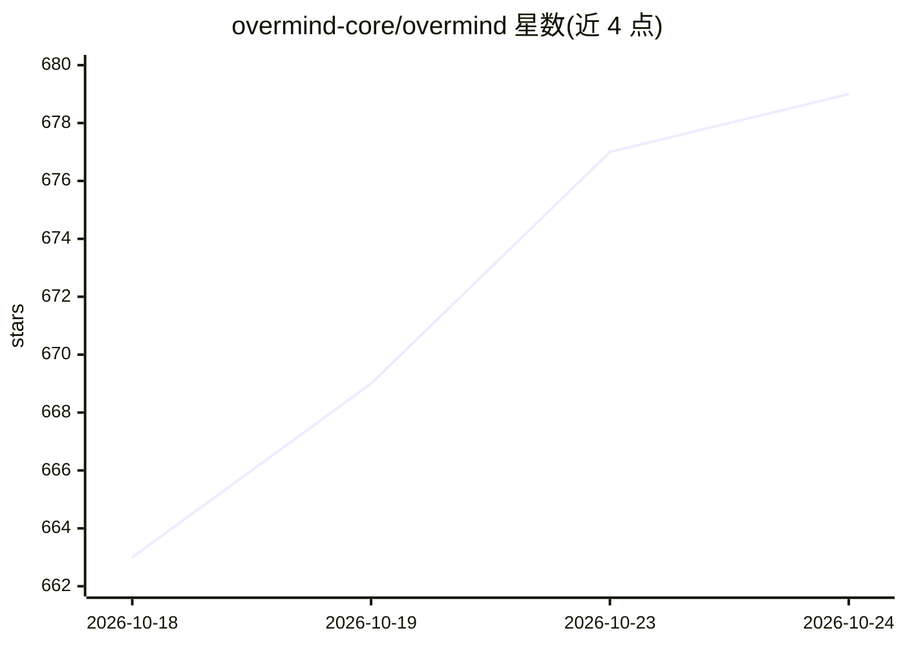

# overmind-core/overmind

⭐ 679 · Python · AGPL-3.0 · 推送 2026-10-23 · [GitHub](https://github.com/overmind-core/overmind) · [官网](https://overmindlab.ai) · 组织维护

**面向 AI agent 的持续训练与改进平台：traces→数据集→微调→评测**

Overmind 是一个 agent 训练与改进平台：读取生产 OpenTelemetry traces（或上传数据）构建版本化数据集，按能力定义 eval 指标，运行 prompt/工具/控制流优化实验，用自有数据微调模型并可与 frontier 模型经统一 OpenAI 兼容 API 服务；权重可下载、重训、回滚。面向开发者与团队，提供托管 Console 与 AGPL-3.0 自托管（Docker Compose 起 Postgres/Redis/API/Celery/Grafana），SDK/CLI 为 MIT 并附 MCP server 接入 Cursor、Claude Code、OpenCode、Codex。自托管需配置 OpenRouter、Modal、AWS 等外部服务的密钥，训练与推理依赖 Modal workers；另有商业许可选项。

## 筛选速览

| 维度 | 判定 | 备注 |
|---|---|---|
| AI 角色 | `ai-ecosystem` | LLM/agent 周边工具 |
| 许可风险 | `dual` | AGPL-3.0 |
| 部署形态 | `self-host` | docker 或自建部署 |
| 模型依赖 | locked-api |  |
| 硬件要求 | — | 无带数字的原话,不猜 |
| 安装摩擦 | `low` | 无编译、无系统依赖或容器化 |
| 成熟度 | — | 结构信号不足 |

## 能力要点

- 生产 traces 转版本化评测/训练数据集，能力级评分
- prompt/工具/控制流优化实验，获胜结果以 git diff 交付
- 微调模型归用户所有，经统一 OpenAI 兼容 API 服务
- MCP server + CLI + REST API，支持自托管（Docker Compose）

## 适用场景

- 从生产 traces 持续评测并微调自己的 coding agent
- 对比微调模型与 frontier 模型在自家任务上的表现
- 数据不出内网的自托管 LLMOps 流水线

## 场景标签

`模型评测` `微调` `MLOps` · 领域:评测与运维

## 证据(README 行号)

> L18: Point it at your agent's codebase and it turns production traces (or any dataset) into a fine-tuned model, benchmar
> L29:  Models Fine-tunes you own, trained on your data and benchmarked against production.

## 星数曲线

2026-10-18 663 → 2026-10-24 679（+16）

---
*卡片 v1 · prompt 1.4 · 生成 2026-10-22 · 置信度 high · 依据 README sha `622643121a6e` · [字段定义](../../DATASET.md)*
