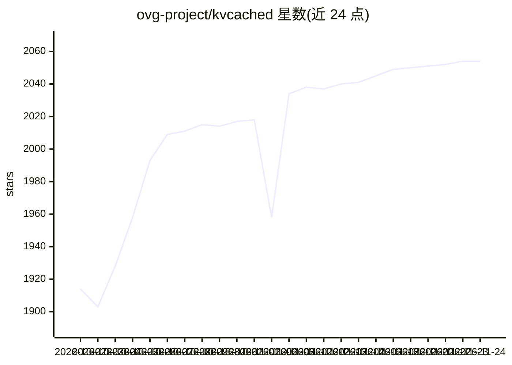

# ovg-project/kvcached

⭐ 2,055 · Python · Apache-2.0 · 推送 2026-11-23 · [GitHub](https://github.com/ovg-project/kvcached) · 组织维护

**给 LLM 推理引擎提供共享 GPU 上弹性 KV cache 的库**

kvcached 是面向 LLM serving/training 场景的 KV cache 库，引入操作系统式虚拟内存抽象，将 GPU 虚拟地址与物理内存分配解耦：先保留虚拟内存，缓存实际使用时再绑定物理显存，实现按需分配与多模型弹性共享。以插件形式集成到 SGLang 与 vLLM，通过环境变量启用，支持前缀缓存、流水线并行、内存上限控制、前端路由与空闲休眠，提供 PyPI、源码与 Docker 三种安装方式，要求 Python 3.10-3.13 与 PyTorch ≥ 2.10。

## 筛选速览

| 维度 | 判定 | 备注 |
|---|---|---|
| AI 角色 | `ai-ecosystem` | LLM/agent 周边工具 |
| 许可风险 | `permissive` | Apache-2.0 |
| 部署形态 | `self-host` | docker 或自建部署 |
| 模型依赖 | local-ok | 支持本地模型 |
| 硬件要求 | — | 无带数字的原话,不猜 |
| 安装摩擦 | `low` | 无编译、无系统依赖或容器化 |
| 成熟度 | — | 结构信号不足 |

## 能力要点

- KV cache 弹性分配与回收，运行时映射解耦逻辑与物理显存
- 以插件方式集成 SGLang 与 vLLM，环境变量启用无需改引擎
- 支持 vLLM APC 与 SGLang RadixCache 前缀缓存、流水线并行
- 支持 NVIDIA CUDA 与 AMD ROCm，ROCm 默认非连续布局

## 适用场景

- 多个 LLM 在同一 GPU 上弹性共存部署，省去静态显存划分
- Serverless 场景下模型按需启停、按需分配 KV 内存
- 检索/推理/摘要等多模型流水线在有限显存上运行
- LLM 推理与训练、微调等其他 GPU 任务共存

## 场景标签

`推理引擎` · 领域:训练与推理

## 证据(README 行号)

> L18: kvcached (KV cache daemon) is a KV cache library for LLM serving/training on **shared GPUs**. By bringing OS-style 
> L29: - **Support mainstream serving engines**: integrate with SGLang and vLLM.
> L96: - SGLang (tested with v0.5.20) or vLLM (tested with v0.30.0)

## 星数曲线

2026-10-22 1,914 → 2026-11-24 2,054（+140）

---
*卡片 v1 · prompt 1.4 · 生成 2026-11-23 · 置信度 high · 依据 README sha `2fc4cbccf5ae` · [字段定义](../../DATASET.md)*
