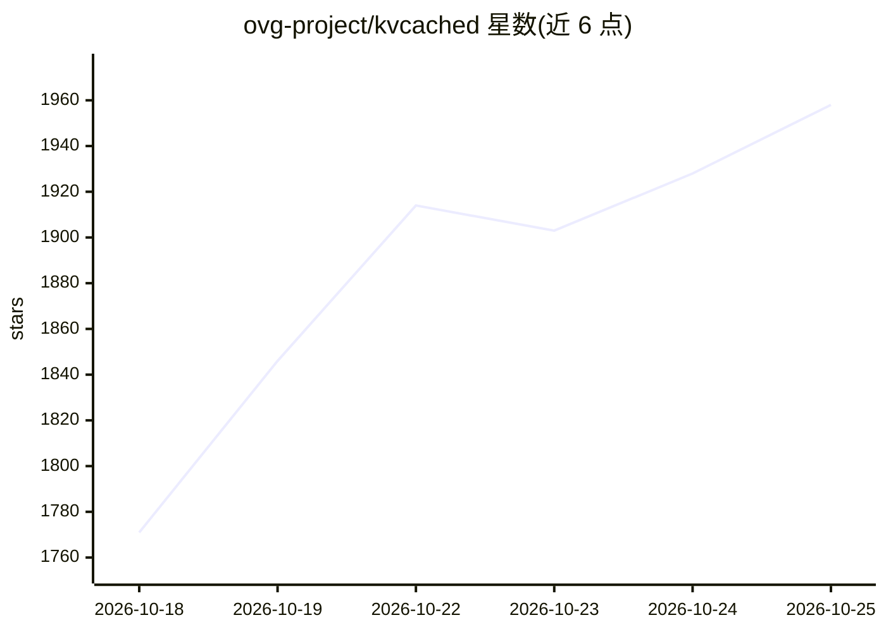

# ovg-project/kvcached

⭐ 1,993 · Python · Apache-2.0 · 推送 2026-10-23 · [GitHub](https://github.com/ovg-project/kvcached) · 组织维护

**共享 GPU 上 LLM 服务的弹性 KV 缓存内存管理库**

面向 LLM serving/training 的 KV cache 守护库，将 OS 式虚拟内存抽象引入 LLM 系统：解耦 GPU 虚拟地址与物理内存分配，按需为 KV 缓存分配显存，支持动态负载下的多模型共享 GPU。以插件形式接入 SGLang（≥v0.5.11）与 vLLM（≥v0.17.0），提供弹性 KV 缓存、内存限额控制、前端路由与模型休眠、自动前缀缓存；支持 NVIDIA 与 AMD ROCm。通过 pip 或 Docker 安装，需 PyTorch ≥2.10，从源码构建。

## 筛选速览

| 维度 | 判定 | 备注 |
|---|---|---|
| AI 角色 | `ai-ecosystem` | LLM/agent 周边工具 |
| 许可风险 | `permissive` | Apache-2.0 |
| 部署形态 | `self-host` | docker 或自建部署 |
| 模型依赖 | local-ok | 支持本地模型 |
| 硬件要求 | — | 无带数字的原话,不猜 |
| 安装摩擦 | `low` | 无编译、无系统依赖或容器化 |
| 成熟度 | — | 结构信号不足 |

## 能力要点

- 弹性 KV 缓存：按实时负载动态分配与回收 KV 显存
- 以插件形式接入 SGLang 与 vLLM，无需修改引擎
- 前端路由与模型空闲休眠，支持多模型共享单卡
- 自动前缀缓存（vLLM APC / SGLang RadixCache）

## 适用场景

- 多模型共享单张 GPU 部署，避免静态显存切分
- Serverless 场景按需启停模型的 KV 缓存分配
- LLM 推理与训练等其他 GPU 负载共存
- A100 等单卡上并发服务多个 LLM 降低成本

## 场景标签

`推理引擎` · 领域:训练与推理

## 证据(README 行号)

> L18: kvcached (KV cache daemon) is a KV cache library for LLM serving/training on **shared GPUs**. By bringing OS-style 
> L29: - **Support mainstream serving engines**: integrate with SGLang and vLLM.

## 星数曲线

2026-10-18 1,771 → 2026-10-25 1,958（+187）

---
*卡片 v1 · prompt 1.4 · 生成 2026-10-21 · 置信度 high · 依据 README sha `4f8d6df3a532` · [字段定义](../../DATASET.md)*
