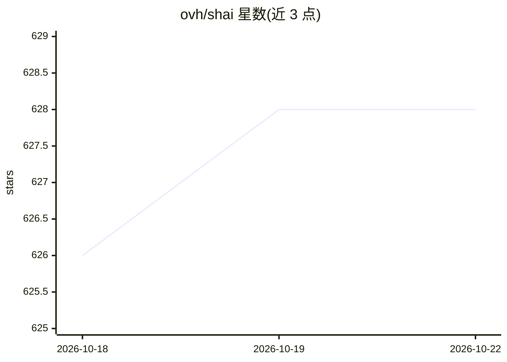

# ovh/shai

⭐ 628 · Rust · Apache-2.0 · 推送 2026-10-09 · [GitHub](https://github.com/ovh/shai) · 组织维护

**终端 AI 编程助手：对话写代码、修 Bug 与命令修复建议**

用 Rust 编写的终端编码 agent，面向开发者的结对编程工具。提供交互式 TUI、无头管道模式、带 OpenAI 兼容 API 与 SSE 流式的 HTTP 服务模式，以及命令失败时自动建议修复的 Shell 助手。支持 OVHcloud、OpenAI、Anthropic、Mistral、Ollama、OpenRouter 等多个 LLM 提供商，默认匿名使用 OVHcloud 端点（限速 2 次/分钟，认证后 400 次/分钟）。支持 MCP+OAuth、AGENTS.md 项目上下文、可组合 Skills 与自定义 agent 配置。通过官方 install.sh 安装二进制。

## 筛选速览

| 维度 | 判定 | 备注 |
|---|---|---|
| AI 角色 | `ai-native` | 本体是模型或模型工具 |
| 许可风险 | `permissive` | Apache-2.0 |
| 部署形态 | `None` |  |
| 模型依赖 | local-ok | 支持本地模型 |
| 硬件要求 | — | 无带数字的原话,不猜 |
| 安装摩擦 | `medium` | 含编译或系统依赖之一 |
| 成熟度 | — | 结构信号不足 |

## 能力要点

- 交互式 TUI、无头管道与 OpenAI 兼容 HTTP 服务三种运行模式
- 命令失败时自动建议修复的 Shell 助手（终端钩子监测）
- 支持 OVHcloud/OpenAI/Anthropic/Mistral/Ollama/OpenRouter 多提供商
- MCP+OAuth、AGENTS.md 项目上下文与可组合 Skills 扩展机制

## 适用场景

- 在终端与 AI 对话编写代码、修复 Bug
- 通过管道把 shai 嵌入脚本与自动化流程
- 命令行出错时获取修复建议

## 场景标签

 · 领域:开发者工具/AI 编程

## 证据(README 行号)

> L3: shai is a coding agent, your pair programming buddy that lives in the terminal. Written in rust with love <3
> L9: - **Interactive coding agent** — Chat with shai in your terminal to write code, fix bugs, and get answers

## 星数曲线

2026-10-18 626 → 2026-10-22 628（+2）

---
*卡片 v1 · prompt 1.4 · 生成 2026-10-21 · 置信度 high · 依据 README sha `a983b3339f34` · [字段定义](../../DATASET.md)*
