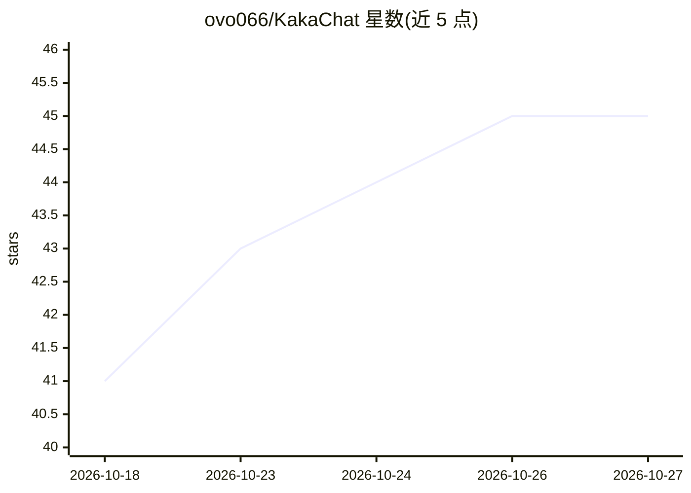

# ovo066/KakaChat

⭐ 45 · JavaScript · NOASSERTION · 推送 2026-10-13 · [GitHub](https://github.com/ovo066/KakaChat) · 个人维护 · 中文 README

**仿 iMessage 风格的 AI 角色扮演聊天 PWA，浏览器本地运行**

基于 Vue 3 + Vite + Pinia 构建的仿 iMessage 界面 AI 角色扮演/陪伴聊天 Web 应用（PWA）。支持 1:1 聊天与群聊、朋友圈、世界书关键词注入、AI 语音/视频通话、主动消息、逐联系人记忆管理，可导入 SillyTavern 角色卡（PNG/JSON，V1/V2/V3）。兼容 OpenAI 格式 API（含中转站），原生支持 Claude 与 Gemini 接口，联网搜索（Tavily/Exa/Firecrawl）与 MCP 工具调用。数据存于浏览器本地 IndexedDB，构建产物为纯静态文件可自托管；许可证为 AGPL-3.0 + Commons Clause。

## 筛选速览

| 维度 | 判定 | 备注 |
|---|---|---|
| AI 角色 | `ai-native` | 本体是模型或模型工具 |
| 许可风险 | `none` | NOASSERTION |
| 部署形态 | `library` | 以包/库形式分发 |
| 模型依赖 | locked-api |  |
| 硬件要求 | — | 无带数字的原话,不猜 |
| 安装摩擦 | `low` | 无编译、无系统依赖或容器化 |
| 成熟度 | — | 结构信号不足 |

## 能力要点

- 导入 SillyTavern 角色卡（PNG/JSON，V1/V2/V3）及内嵌世界书
- AI 通话（语音/视频模拟，STT + TTS）与主动消息、情绪状态引擎
- 兼容 OpenAI 格式 API，原生支持 Claude / Gemini / OpenAI Responses 接口
- 数据全部保存在浏览器本地 IndexedDB，可安装为 PWA

## 适用场景

- 在浏览器中与 AI 角色进行拟真消息式角色扮演
- 导入已有的酒馆角色卡和世界书继续对话
- 自托管一个纯静态部署的 AI 聊天应用，数据留在本地

## 场景标签

`聊天机器人` · 领域:对话与助手

## 证据(README 行号)

> L8: 仿 iMessage 风格的 AI 角色扮演聊天应用，基于 Vue 3 + Vite + Pinia 构建。在浏览器中模拟真实手机界面，与 AI 角色自然对话——像和真人发消息一样。
> L10: > An iMessage-style AI roleplay / companion chat web app (PWA). Group chats, moments feed, lorebooks, voice calls, 

## 星数曲线

2026-10-18 41 → 2026-10-27 45（+4）

---
*卡片 v1 · prompt 1.4 · 生成 2026-10-25 · 置信度 high · 依据 README sha `758e6f075b3b` · [字段定义](../../DATASET.md)*
