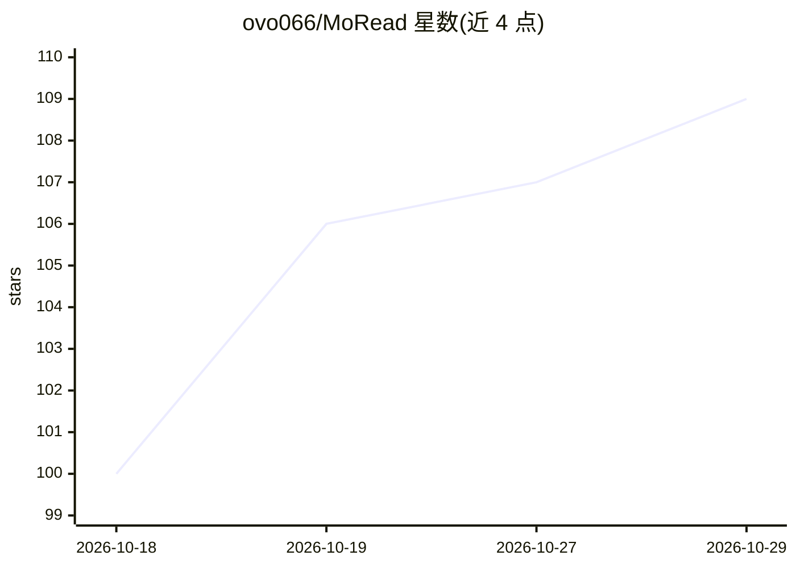

# ovo066/MoRead

⭐ 109 · Kotlin · GPL-3.0 · 推送 2026-10-21 · [GitHub](https://github.com/ovo066/MoRead) · 个人维护 · 中文 README

**本地优先的 Android 小说阅读器，可选 BYOK AI 伴读**

原生 Android 本地图书阅读应用，支持 TXT/EPUB 导入、自绘排版引擎（含竖排 RTL）、章节分割、听书（系统 TTS 与多家云端 TTS）、MDX 词典、标注笔记与阅读统计。AI 为可选功能：用户自带 API key（BYOK）直连 OpenAI 兼容/OpenAI Responses/Claude/Gemini 四种流式协议，提供角色卡导入（SillyTavern）、向量+词法检索的阅读 Agent、长程记忆、防剧透边界与配图生成。无 API key 时可作为完整离线阅读器使用。GPL-3.0，界面目前以中文为主。

## 筛选速览

| 维度 | 判定 | 备注 |
|---|---|---|
| AI 角色 | `ai-enhanced` | 去掉 AI 部分产品仍成立 |
| 许可风险 | `viral` | GPL-3.0 |
| 部署形态 | `None` |  |
| 模型依赖 | locked-api |  |
| 硬件要求 | — | 无带数字的原话,不猜 |
| 安装摩擦 | `medium` | 含编译或系统依赖之一 |
| 成熟度 | — | 结构信号不足 |

## 能力要点

- BYOK 直连四类流式协议（OpenAI 兼容/Responses/Claude/Gemini），聊天/嵌入/语音/图像模型可分别指定
- SillyTavern 角色卡导入与向量+词法检索的阅读 Agent、按书/角色/人设分域的长期记忆
- 本地优先：书库数据存本机、无账号与分析、API key 存 EncryptedSharedPreferences、可选 WebDAV 备份
- 自绘排版引擎支持竖排直排标点、RTL 竖排 EPUB 排版与多主题

## 适用场景

- 离线阅读本地 TXT/EPUB 小说，无需账号
- 自带 API key 让 AI 伴读角色讨论剧情且不剧透未读部分
- 长篇小说的章节大纲、全书人物卡与连续听书
- 为书籍生成风格化插画与段落角色批注

## 场景标签

`语音合成` `聊天机器人` `图像生成` · 领域:对话与助手

## 证据(README 行号)

> L13: MoRead is a local-first reading app with no account requirement or analytics. Import your own books and, optionally
> L49: ### AI companion · bring your own API key

## 星数曲线

2026-10-18 100 → 2026-10-29 109（+9）

---
*卡片 v1 · prompt 1.4 · 生成 2026-10-23 · 置信度 high · 依据 README sha `473759e279ff` · [字段定义](../../DATASET.md)*
