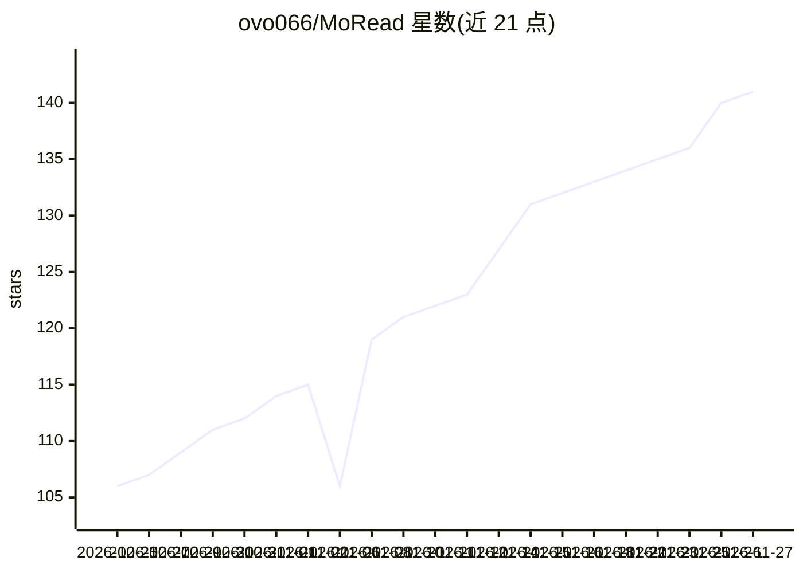

# ovo066/MoRead

⭐ 141 · Kotlin · GPL-3.0 · 推送 2026-11-20 · [GitHub](https://github.com/ovo066/MoRead) · 个人维护 · 中文 README

**本地小说阅读 Android 应用，可选接入自有 API key 的 AI 伴读**

本地优先的 Android 阅读应用（Android 8.0+），无需账号与后端服务：支持 TXT/EPUB/Markdown/HTML/无 DRM MOBI 导入，自绘排版引擎覆盖分页动画、竖排、注释、词典查询、统计与听书。AI 部分为可选项（BYOK）：配置 OpenAI 兼容、Claude、Gemini 等协议后提供角色卡伴读、章节大纲、向量/词法检索的阅读 agent、插画生成与多种 TTS 语音。无网络或 API key 时仍是完整离线阅读器。界面以中文为主，英文翻译未完成。

## 筛选速览

| 维度 | 判定 | 备注 |
|---|---|---|
| AI 角色 | `ai-enhanced` | 去掉 AI 部分产品仍成立 |
| 许可风险 | `viral` | GPL-3.0 |
| 部署形态 | `None` |  |
| 模型依赖 | — | README 未给出锁定关系 |
| 硬件要求 | — | 无带数字的原话,不猜 |
| 安装摩擦 | `medium` | 含编译或系统依赖之一 |
| 成熟度 | — | 结构信号不足 |

## 能力要点

- BYOK 直连 AI 提供商，无代理服务器，API key 存于 EncryptedSharedPreferences
- 四种流式协议：OpenAI 兼容、OpenAI Responses、Claude、Gemini，聊天/嵌入/语音/图像模型可独立分配
- 导入 SillyTavern PNG/JSON 角色卡与世界书，伴读遵守防剧透进度边界
- 对话摘要为可检索长期记忆，按书籍、角色与用户人设限定范围

## 适用场景

- 离线阅读本地 TXT/EPUB 小说并做注释与词典查询
- 为在读小说配置角色卡伴读与章节大纲
- 用自有 API key 生成插画与角色配音听书
- 多语言阅读时使用段落翻译与注音

## 场景标签

`语音合成` · 领域:内容生成

## 证据(README 行号)

> L13: MoRead is a local-first reading app with no account requirement or analytics. Import your own books and, optionally
> L49: ### AI companion · bring your own API key

## 星数曲线

2026-10-25 106 → 2026-11-27 141（+35）

---
*卡片 v1 · prompt 1.4 · 生成 2026-11-27 · 置信度 high · 依据 README sha `916dd2276eb4` · [字段定义](../../DATASET.md)*
