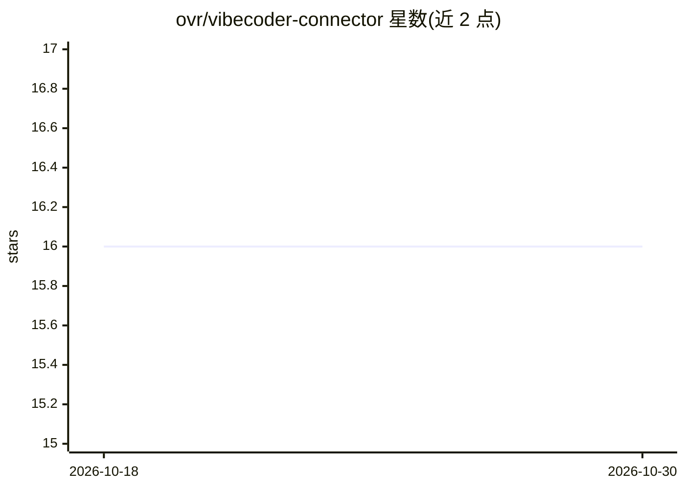

# ovr/vibecoder-connector

⭐ 16 · HTML · MIT · 推送 2026-04-01 · [GitHub](https://github.com/ovr/vibecoder-connector) · 个人维护

**Claude Code 会话触觉反馈插件：用振动设备传递通知**

面向 Claude Code 用户的 npm 插件，通过 Intiface Central 的 WebSocket 服务连接 Buttplug 兼容振动设备，在会话开始、需要授权/关注、任务完成三类事件时输出振动模式（hello/attention/complete），模式可在 patterns.json 中自定义并支持强度倍率调节。README 中的'研究数据'（AGI 2026、n=1 实验、由 Claude 模型同行评审的白皮书）为戏谑性表述，不构成可验证的科学依据。

## 筛选速览

| 维度 | 判定 | 备注 |
|---|---|---|
| AI 角色 | `ai-ecosystem` | LLM/agent 周边工具 |
| 许可风险 | `permissive` | MIT |
| 部署形态 | `library` | 以包/库形式分发 |
| 模型依赖 | — | README 未给出锁定关系 |
| 硬件要求 | — | 无带数字的原话,不猜 |
| 安装摩擦 | `low` | 无编译、无系统依赖或容器化 |
| 成熟度 | — | 结构信号不足 |

## 能力要点

- 会话开始/需关注/任务完成三类事件触发三种振动模式
- 经 Intiface Central WebSocket 连接 Buttplug 兼容设备
- patterns.json 自定义振动序列，自动加载；全局强度倍率可调
- npm 全局安装后注册到 Claude Code settings.json 即可使用

## 适用场景

- 离开屏幕时通过体感振动得知 Claude Code 需要授权或已完成任务
- 为 Claude Code 会话事件添加自定义触觉提醒

## 场景标签

 · 领域:开发者工具/硬件外设

## 证据(README 行号)

> L6:  Haptic feedback from connected devices during Claude Code sessions via Intiface Central.
> L58: ### 3. Register with Claude Code
> L70: That's it. Start a Claude Code session and feel the vibe.

## 星数曲线

2026-10-18 16 → 2026-10-30 16（+0）

---
*卡片 v1 · prompt 1.4 · 生成 2026-10-30 · 置信度 high · 依据 README sha `d8acf327e68d` · [字段定义](../../DATASET.md)*
