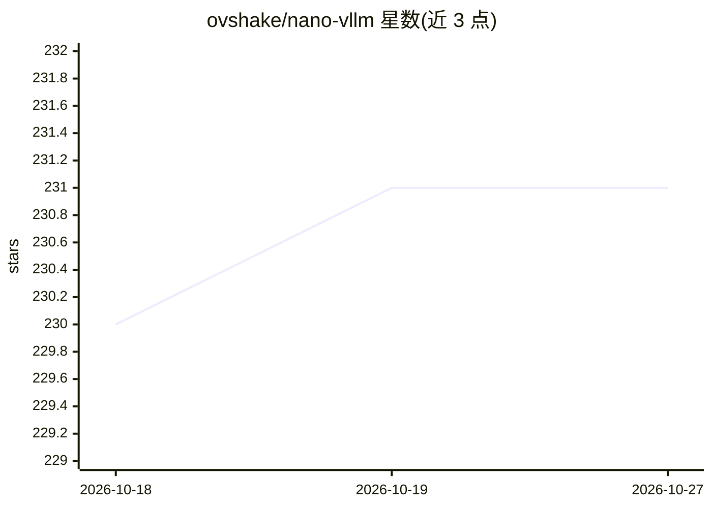

# ovshake/nano-vllm

⭐ 231 · Python · Apache-2.0 · 推送 2026-01-25 · [GitHub](https://github.com/ovshake/nano-vllm) · 个人维护

**面向学习者的极简 LLM 推理引擎实现，讲解推理原理**

受 vLLM 启发的教学型 LLM 推理引擎：实现连续批处理、PagedAttention、FlashAttention、GQA、优先级调度、抢占、分块预填充、前缀缓存与投机解码等机制，可从 HuggingFace 模型 ID 或本地路径加载模型生成文本。特色是四种教学模式：Narrator 实时英文讲解、X-Ray 展示张量形状与矩阵运算、Dashboard 终端仪表盘、Tutorial 交互式教程。要求 Python 3.10+ 与 PyTorch 2.0+，rich 与 flash-attn 为可选依赖。

## 筛选速览

| 维度 | 判定 | 备注 |
|---|---|---|
| AI 角色 | `ai-ecosystem` | LLM/agent 周边工具 |
| 许可风险 | `permissive` | Apache-2.0 |
| 部署形态 | `library` | 以包/库形式分发 |
| 模型依赖 | — | README 未给出锁定关系 |
| 硬件要求 | — | 无带数字的原话,不猜 |
| 安装摩擦 | `medium` | 含编译或系统依赖之一 |
| 成熟度 | — | 结构信号不足 |

## 能力要点

- 连续批处理、PagedAttention、优先级调度、分块预填充、前缀缓存与投机解码实现
- 四种教学模式：Narrator/X-Ray/Dashboard/Tutorial
- CLI 支持多提示词、优先级、设备与精度选择
- 提供调度器与对比 HuggingFace Transformers 的基准测试

## 适用场景

- 学习 LLM 推理引擎内部机制（批处理、KV 缓存、调度）
- 交互式了解推理各阶段的张量运算
- 运行小模型生成文本并观察调度行为

## 场景标签

`推理引擎` `教程课程` · 领域:学习与行业

## 证据(README 行号)

> L5: A minimalistic, educational implementation of a high-performance LLM inference engine, inspired by vLLM.
> L19: - **Continuous Batching**: Process multiple requests simultaneously with iteration-level scheduling

## 星数曲线

2026-10-18 230 → 2026-10-27 231（+1）

---
*卡片 v1 · prompt 1.4 · 生成 2026-10-22 · 置信度 mid · 依据 README sha `d2237867df17` · [字段定义](../../DATASET.md)*
