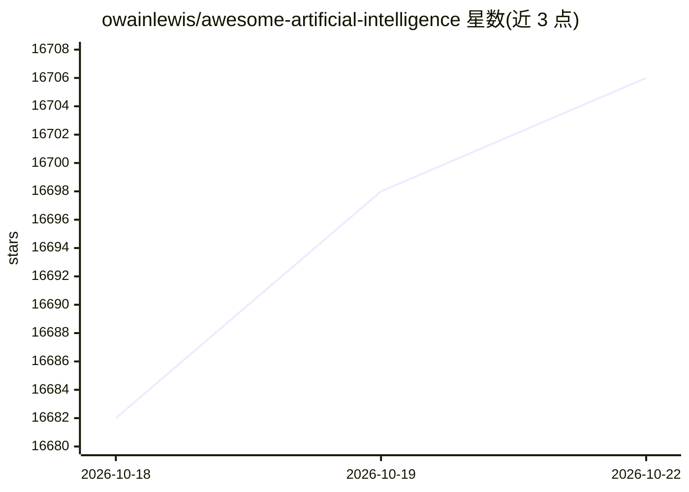

# owainlewis/awesome-artificial-intelligence

⭐ 16,706 · Python · MIT · 推送 2026-08-15 · [GitHub](https://github.com/owainlewis/awesome-artificial-intelligence) · [官网](https://aiengineer.co) · 个人维护

**面向开发者学习构建生成式与 Agent 系统的 AI 资源清单**

一份由自动化流程每周评审维护的 AI 学习与实践资源精选清单，收录书籍、课程、论文、指南与开源工具链接，覆盖基础理论、LLM 应用工程、协议规范、Agent 框架、检索、评估、部署观测及编码 Agent 等分类。声明每条目须经质量门槛筛选，非全量产品目录。以 Markdown 清单形式提供，无安装或运行环节，资源多为外部链接。

## 筛选速览

| 维度 | 判定 | 备注 |
|---|---|---|
| AI 角色 | `ai-knowledge` | 知识聚合/清单类 |
| 许可风险 | `permissive` | MIT |
| 部署形态 | `None` |  |
| 模型依赖 | — | README 未给出锁定关系 |
| 硬件要求 | — | 无带数字的原话,不猜 |
| 安装摩擦 | `low` | 无编译、无系统依赖或容器化 |
| 成熟度 | — | 结构信号不足 |

## 动量与使用信号

- 维护:`active` — 距上次 push 64.0 天,年发版 0,47 位贡献者
- 涨星:近 1 天 **+5**(自 20261016 起算)
- 平台:— · 协议:MCP

## 能力要点

- 按学习路径组织：书籍/课程/基础论文到构建、评估、部署
- 收录 Agent 框架、MCP/A2A 协议及编码 Agent 等工程资源条目
- 声明由证据驱动的自动化流程每周评审与合并更新

## 适用场景

- 系统学习大模型与 Agent 开发的基础知识
- 查找 LLM 应用工程各环节的开源工具与指南
- 按论文（Transformer、RAG、LoRA、RLHF 等）溯源技术原理

## 场景标签

`精选清单` · 领域:学习与行业

## 证据(README 行号)

> L3: An opinionated, actively maintained collection of resources for software developers learning to build and ship gener
> L14: This is not a comprehensive directory of AI products. Every entry must clear an absolute quality bar for technical 
> L20: ## Learn

## 星数曲线

2026-10-18 16,682 → 2026-10-22 16,706（+24）

---
*卡片 v1 · prompt 1.4 · 生成 2026-10-18 · 置信度 high · 依据 README sha `a96b5513d4aa` · [字段定义](../../DATASET.md)*
