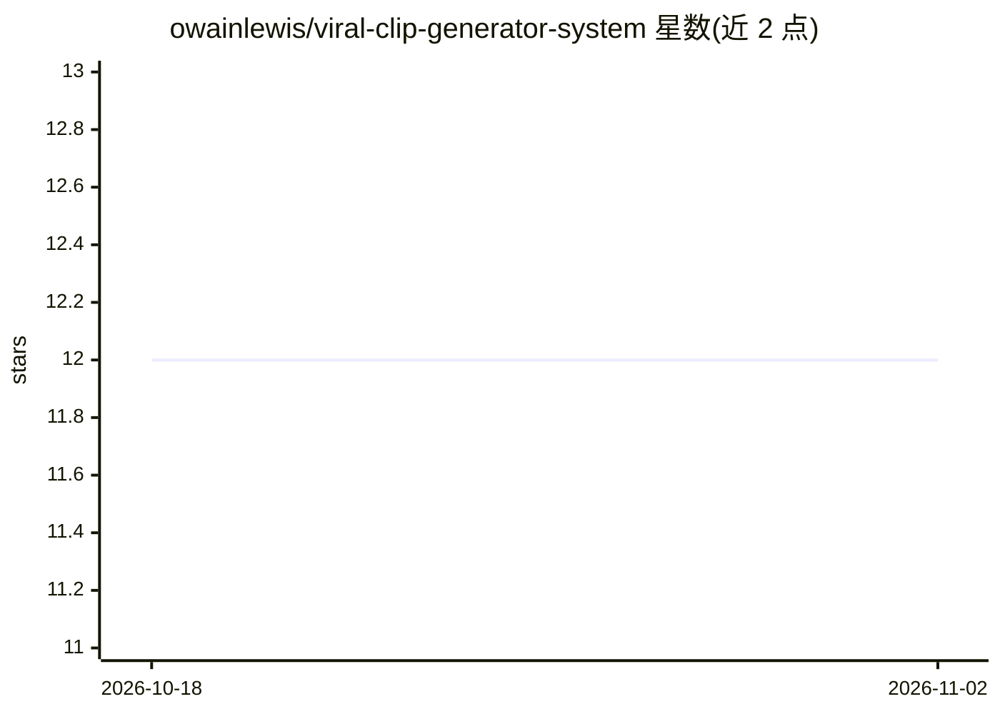

# owainlewis/viral-clip-generator-system

⭐ 12 · Python · 推送 2026-07-14 · [GitHub](https://github.com/owainlewis/viral-clip-generator-system) · 个人维护

**命令行工具：拼接本地 MP4 片段并替换为 MP3 背景音乐**

作者个人用于自动生成 TikTok/Instagram 短视频的命令行工具：从 clips/ 目录按最少使用优先（记录在 clip_usage.json，仅成功创建后计入）选取本地 MP4 片段，用 FFmpeg 无重编码拼接，替换音频为 audio/ 目录的 MP3 背景轨（短音频循环并结尾淡出），输出 H.264/AAC 到 output/。要求 Python 3.13、uv、FFmpeg/FFprobe 在 PATH，源片段需编解码器/分辨率/帧率一致。README 未描述任何 AI 模型调用机制。

## 筛选速览

| 维度 | 判定 | 备注 |
|---|---|---|
| AI 角色 | `ai-enhanced` | 去掉 AI 部分产品仍成立 |
| 许可风险 | `none` | — |
| 部署形态 | `None` |  |
| 模型依赖 | — | README 未给出锁定关系 |
| 硬件要求 | — | 无带数字的原话,不猜 |
| 安装摩擦 | `medium` | 含编译或系统依赖之一 |
| 成熟度 | — | 结构信号不足 |

## 能力要点

- 基于 clip_usage.json 的最少使用优先片段选取，成功后记录
- FFmpeg 无重编码拼接，输出 H.264/AAC
- 背景音不足时循环并在结尾淡出，片段不足时重复使用

## 适用场景

- 批量自动拼接本地素材生成短视频
- 维护素材使用记录避免片段重复

## 场景标签

`图像视频处理` · 领域:感知与多模态

## 证据(README 行号)

> L3: A small command-line tool that joins local MP4 clips and replaces their audio with
> L6: It keeps a local `clip_usage.json` file and selects the least recently used clips

## 星数曲线

2026-10-18 12 → 2026-11-02 12（+0）

---
*卡片 v1 · prompt 1.4 · 生成 2026-11-01 · 置信度 mid · 依据 README sha `c103536da8af` · [字段定义](../../DATASET.md)*
